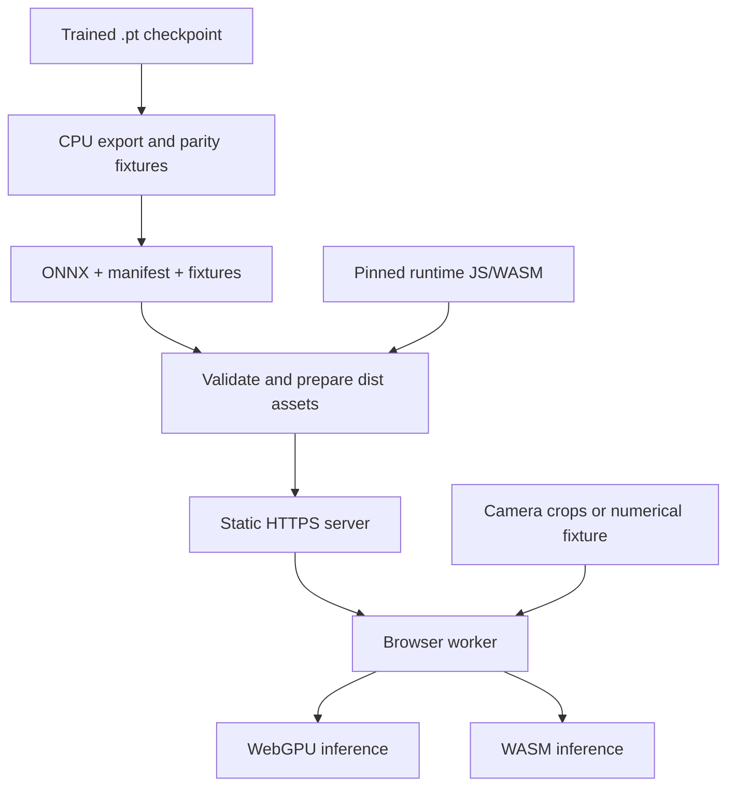

# Neural Corrector Lab — export, serving, and device inference

The Neural Corrector Lab runs the trained U-tube family locally in a browser
worker. It measures PyTorch-to-browser numerical agreement, model loading,
inference time, and camera-burst preparation. The reported successful
`U-tube-2x-attn` training run is ready for this device check.

The serving path already exists. The Python `.pt` file is the training
checkpoint; the browser loads its **ONNX export**, a small manifest and the
pinned ONNX Runtime Web assets. No inference endpoint or Flask application is
needed. The static server never receives camera frames or performs inference.
The current camera probe checks finite model outputs; connecting corrected
scores to live CRC/RS recovery and displaying received content is the next app
integration step, described below.

See the [model family and masks](NEURAL_CORRECTOR.md),
[capture and training guide](NEURAL_CORRECTOR_TRAINING.md), and
[POC roadmap](ROADMAP.md).

## Export the trained checkpoint

From the repository root, with the training virtual environment active:

```sh
python -m pip install -r experiments/neural-corrector/requirements.txt
python experiments/neural-corrector/export.py \
  --checkpoint checkpoints/neural-corrector/U-tube-2x-attn/best.pt \
  --out experiments/neural-corrector/artifacts/selected
npm ci --prefix experiments/neural-corrector/browser-runtime
npm run prepare:apps
npm run prepare:corrector -- --artifacts experiments/neural-corrector/artifacts/selected
npm run test:corrector:wasm -- --artifacts experiments/neural-corrector/artifacts/selected
```

Set the checkpoint path to the local filename you chose. Export infers the
architecture and input shape from the validated checkpoint. It creates fresh
numerical fixtures using those exact weights; omitting `--checkpoint` produces
an **untrained** feasibility model and is unsuitable for a recognition test.
`U-tube-2x-attn` exports G64 only. The two fixed-input profiles can export G64 and
G128, but successful export alone does not establish cross-size recognition.

Export runs on CPU and checks ONNX graph validity plus native ONNX Runtime
agreement with PyTorch. If a particular host cannot initialize the native
runtime, the explicit `--skip-ort-check` option records `not_run`; it does not
count as a passed check. The Node/WASM and actual-device parity tests remain
necessary. The pinned runtime is **ONNX Runtime Web 1.23.2**.

### Rename the descriptive profile in an existing checkpoint

Renaming a directory or `.pt` file does not change the profile name stored
inside it. The successfully trained phase-grouped checkpoint still records
`attention-tube`; the current name is `U-tube-2x-attn`. Before exporting it with
the renamed code, make one explicit metadata-only copy. Adjust `source` if you
have already moved the original file:

```sh
python - <<'PY'
from pathlib import Path
import torch

source = Path('checkpoints/optical-decoder/attention-phase8/best.pt')
target = Path('checkpoints/neural-corrector/U-tube-2x-attn/best.pt')
if target.exists():
    raise FileExistsError(f'Refusing to overwrite {target}')
checkpoint = torch.load(source, map_location='cpu', weights_only=True)
assert checkpoint['format'] == 'optical-decoder-checkpoint'
assert checkpoint['training']['modelProfile'] == 'attention-tube'
checkpoint['training']['modelProfile'] = 'U-tube-2x-attn'
target.parent.mkdir(parents=True, exist_ok=True)
torch.save(checkpoint, target)
print(target)
PY
```

The model tensors, input layout, phase semantics and split provenance remain
unchanged. For the other two models, the descriptive replacements are
`normalized-tube` → `U-tube` and `longtube` → `U-tube-2x`. New training runs
already write the current names. The runtime has no old-name aliases and this
manual operation is not a checkpoint-format conversion.

Persisted format identifiers such as `optical-decoder-checkpoint` and the
recording/dataset format IDs intentionally remain stable. They identify stored
structures, not the component's display name. Existing recording JSON needs no
conversion, and its session/payload ownership information must remain intact.


## What the demo server serves

Preparation validates every source artifact before copying it into the app. It
writes the manifest last, and the browser validates declared byte lengths and
SHA-256 hashes. A partially replaced or mismatched bundle fails validation.

| Location under `apps/color-optical-bench/dist/` | Purpose |
| --- | --- |
| `corrector.html`, `js/corrector-lab/`, `corrector-lab.css` | Lab UI and worker code |
| `models/neural-corrector/manifest.json` | Trained status, profile, input/output contract, versions, artifact hashes and bounded provenance |
| `models/neural-corrector/model-64.onnx` | Browser inference graph and weights |
| `models/neural-corrector/input-64.f32`, `expected-64.f32` | Public numerical fixture and expected PyTorch logits |
| `vendor/onnxruntime/` | Pinned JS/WASM runtime and license notices |

The checkpoint stays outside the served `dist/` directory. At 432,848 parameters,
its roughly 1.7 MB weight payload is small; the current ONNX graph is about
2.84 MB because it also contains graph constants. Runtime assets are additional:
the prepared WASM variants are roughly 12–25 MB each, and the chosen backend
loads its required assets. Cold download/initialization and warm inference are
reported separately. Preparation copies the necessary runtime variants locally;
there is no CDN dependency.



The existing `serve.py` serves only `dist/`, disables directory listings, sends
`Cache-Control: no-cache`, and supplies the camera permissions policy. The
worker fetches the manifest/artifacts with `cache: 'no-cache'` and requires the
same origin. It reuses an initialized session only when the model hash and
requested backend match; changed input/expected hashes also invalidate fixture
buffers. Model hashes are the identity of a prepared model, independently of a
human-friendly checkpoint filename. For this POC, replace the prepared bundle
and reload the page/worker to test a new checkpoint.

### Start the server

For a webcam on the same computer:

```sh
python apps/color-optical-bench/serve.py --port 8000
```

Open `http://localhost:8000/corrector.html`. For a phone, use a certificate that
it trusts and that covers the hostname or IP address used in the browser:

```sh
python apps/color-optical-bench/serve.py \
  --host 0.0.0.0 --port 8000 --https \
  --cert certs/dev.pem --key certs/dev-key.pem
```

Open `https://YOUR-COMPUTER-HOST:8000/corrector.html` on both devices. Ordinary
LAN HTTP does not provide camera access equivalent to localhost. The same
prepared `dist/` directory can also be hosted by a static HTTPS server; preserve
its relative asset paths and JavaScript/WASM MIME types. These commands are
explicit local setup steps and do not reactivate any hosted test site.

## Device checks

1. With the camera off, choose **WASM**, G64 and ten measured runs. The benchmark
   warms up twice, then compares every output logit with the PyTorch fixture.
   The browser tolerance is `abs(actual - expected) <= 1e-4 + 1e-3 * abs(expected)`.
2. Repeat using **Auto**. It selects WebGPU when available; if WebGPU session
   initialization fails it records the reason and tries WASM. Explicit **WebGPU**
   selection reports a failure instead of falling back. WASM uses one thread.
3. Start the camera at 720p and repeat the numerical benchmark. This measures
   contention while the preview is active. Compare 1080p only if useful for the
   intended receiving configuration.
4. On the other device, display the same **64×64/16-color logical matrix in four
   permuted phases**, using grid-8 references. Cycle the phases, align the whole
   marker and select **Test matrix burst**. Test 4, 5, 6, 7 and 8 camera exposures;
   **Model default** collects eight. Four means one distinct capture per phase.
5. Reverse the devices and repeat. Try cancel/restart, and save both successful
   and failed device reports before leaving the page.

Fixed-input U-tube profiles accept only their configured T and collect one
header/phase. `U-tube-2x-attn` accepts K=4–8, with phase pairs
`P0a,P0b,P1a,P1b,P2a,P2b,P3a,P3b` and eight binary presence planes. It keeps at
most two captures per phase and requires all four phases. A matching phase
change preserves the partial group. Brief detection failures retain prior
valid phases; a different logical header, a new run, cancel/restart, or evidence
older than 60 seconds clears the group. Video timestamps and presented-frame
counters enforce distinct exposures.

Collection targets 100 ms start-to-start sampling, with at most 512 attempts
and eight stored crops for phase-grouped input. Processing can reduce that rate.
Phase display time, camera settling and inference all contribute to latency:
four captures do not imply a 400 ms authentication or transfer. Fewer captures
also do not shrink the fixed eight-slot neural graph.

Reports contain model/runtime hashes, backend and fallback, parity, p50/p95
warm inference time, load/init time, camera settings and per-phase capture
counts. Known buffer sizes are partial accounting, not total worker/GPU memory.
No camera images, payloads or keys are included. Reports stay in memory and are
capped at 50 tests; hidden pages stop camera capture and pending worker work.

## The next integration step

The score adapter is implemented and tested: it excludes reference cells and
inactive palette classes, converts physical outputs to logical scores for the
fixed-input models, and passes the phase-grouped model's canonical output
through without a second palette inversion. Offline evaluation already sends
these scores to the existing RS/CRC pipeline.

The current lab's camera button performs crop preparation and finite-logit
inference only. It does **not** yet display a recovered message or insert neural
evidence into live optical transport. The next demo increment will:

1. Run the selected trained model on a valid four-phase camera group.
2. Pass its logical scores through the existing byte/RS/CRC decoder and show
   accepted content plus correction/inference timings.
3. Attempt K=4 first, add available observations through K=8 when CRC fails,
   and then replace stale captures or time out with bounded memory.
4. Compare acknowledged application-byte throughput in both directions, then
   connect the working channel to the existing Neural ZKBoo authentication flow.

CRC acceptance remains mandatory; known sender payloads are only used in offline
measurement after recovery. The camera path never receives labels or a clean
reference matrix. The successful recorded validation motivates this device
integration; it does not establish live recovery or throughput by itself.

## Automated checks

```sh
npm run test:corrector
python -m unittest discover -s experiments/neural-corrector/tests -v
npm run test:corrector:wasm -- --artifacts experiments/neural-corrector/artifacts/selected
```

The Node command uses the browser runtime's WASM provider against exported
PyTorch fixtures. Actual browser WebGPU behavior, camera contention and physical
capture quality still require the device checklist. See
[VALIDATION.md](VALIDATION.md) for implementation checks and reported device runs.
