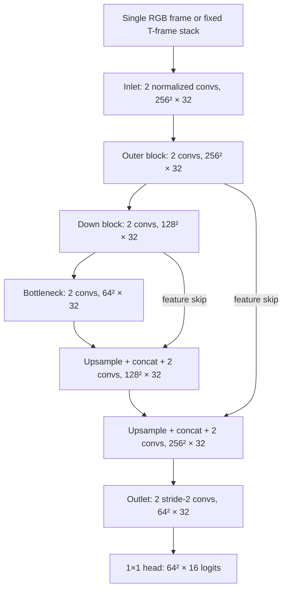
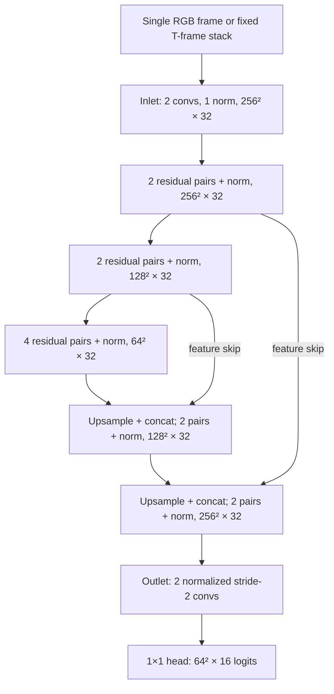
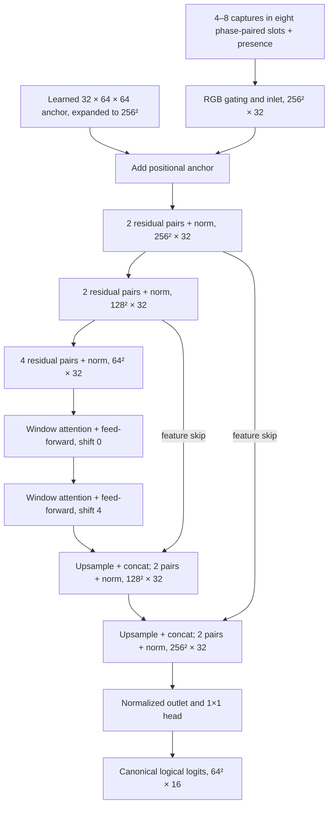
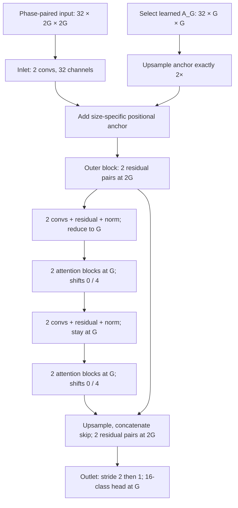

# Neural corrector: model family and architecture

The **neural corrector** estimates a corrected optical matrix from one or more
camera observations. It learns to resolve color ambiguity, moiré, blur, lighting
variation and capture noise after the receiver has detected and rectified the
matrix. Its output is a score for every palette class at every matrix cell.
The receiver can turn those scores into a corrected color matrix or pass the
soft evidence to its existing byte decoder and error-recovery code.

These are separate responsibilities: the corrector predicts symbols; the
transport decoder interprets symbols as bytes and checks CRC/Reed–Solomon
constraints. The network receives neither expected payload bytes nor secret
cryptographic material. Corrected appearance or high confidence alone never
accepts a payload.

See the [capture and training guide](NEURAL_CORRECTOR_TRAINING.md) for dataset
commands, the [experiment README](../experiments/neural-corrector/README.md) for
entry points, and the [Corrector Lab guide](CORRECTOR_LAB.md) for exporting and
serving a trained model.

Original Neural-Corrector code and documentation use [Apache-2.0](../LICENSE),
with credit to Neural Cryptography and **Alejandro Hernandez Ruiz (magnux)** in
[NOTICE](../NOTICE). See [licensing scope](LICENSING.md) for model releases.

The next optical transport is [Neural-QR](NEURAL_QR.md). Its acquisition design
replaces the current separately decoded header with geometric anchors and phase
cues while reusing the palette, phase grouping and logical-label conventions. The
header-based descriptions below document the currently implemented OBM5 path;
they are not a requirement for future neural input preparation.

The next model is **`multires`**, with a shared convolution/attention trunk and
an independent learned positional anchor for every supported size, G8…G256.
Its bottleneck alternates two convolutions, two attention blocks, two
convolutions and two attention blocks.
See [multires design](#multires-next-architecture).
The production implementation and trained checkpoint are currently G64.
The new design uses **2×2 pixels per cell (four pixels total)**. The currently
implemented models documented below use 4×4; the new shape contract and spatial
strides are specified in the multi-resolution section, not yet in production code.

## Currently implemented input and output contract

Let **G** be the matrix width in cells, **T** a fixed number of observations,
**K** the number of available observations in a variable input, and **N** the
batch size. A rectified crop has four pixels per cell along each axis: a G64
matrix produces a 256×256 RGB crop. The crop includes the colored reference
grid; it does not include the full camera image or monochrome transport header.
Detection, header validation, rectification and color calibration remain outside
the network.

| Input form | Models | Input tensor | Observation rule |
| --- | --- | --- | --- |
| Single frame | U-tube, U-tube-2x | `[N,3,4G,4G]` | One rectified observation |
| Fixed frame burst | U-tube, U-tube-2x | `[N,3T,4G,4G]` | T distinct observations of the same logical matrix and palette phase; T=1…64 |
| Phase-grouped burst | U-tube-2x-attn | `[N,32,256,256]` | Eight phase-paired RGB slots plus eight presence planes; K=4…8 |

Every model produces **`logits: [N,16,G,G]`**. These are unnormalized class
scores, not a rendered RGB image. Softmax over the active palette produces
per-cell probabilities; argmax produces one discrete symbol per cell. Preserving
probabilities allows the byte decoder to use uncertainty during error recovery.
The corrected logical data matrix is the common external result, although the
models use two internal label conventions:

- **U-tube and U-tube-2x** predict physical displayed palette classes. The
  receiver uses the validated phase header to reverse that palette mapping.
- **U-tube-2x-attn** predicts canonical, phase-zero logical data classes directly.
  Its output must not undergo another phase reversal.

Reference-grid cells occupy positions in the output tensor but are excluded from
payload scores and the supervised loss. The current fixed-frame models support
G64/G128 and 4/16 colors. The phase-grouped model is specifically G64, 16 colors,
four permuted phases. Structural G128 export support does not demonstrate that
weights trained on G64 recognize G128 captures; train and validate each size.

### RGB normalization

For calibrated RGB value `c` in camera-byte units, stored crop conversion is:

```text
stored = clip(c / 127.5 - 1, -1.5, 1.5)
network RGB = clip(stored, -1, 1)
```

Color correction may overshoot the original byte range. The wider storage bound
preserves that evidence in existing recordings. All models apply the same final
`[-1,1]` clamp before learned processing, for both real and synthetic inputs;
that clamp is part of the exported ONNX graph. Presence planes are binary flags,
not RGB values. The fixed-frame stack order is `R0,G0,B0,R1,G1,B1,...`.

## Architecture design

**U** refers to the U-Net path: spatial reduction gathers context, spatial
expansion reconstructs fine features, and skip connections retain evidence from
corresponding resolutions. **Tube** refers to the constant **32 output channels
per resolution block**. Concatenating a skip temporarily creates 64 channels,
which the receiving block reduces to 32; the inlet and final 16-class head are
also exceptions to the internal width.

The full-resolution rule is central to this family:

1. The inlet and outer U operate at the entire rectified crop resolution, **4G**.
2. The U bottleneck is **G**, exactly the target matrix resolution.
3. The reconstruction path returns to **4G** before the outlet reduces features
   through **2G** to **G**.

For G64 this is a **256→128→64→128→256** U, followed by a **256→128→64** outlet.
For a separately trained G128 fixed-frame model, it is a
**512→256→128→256→512** U, then **512→256→128**. The architecture does not add
coarser-than-cell stages. Payload symbols are effectively random, so preserving
local measurements is more useful than assuming large semantic image structures.
This is a design choice supported by the experiments, not a claim that all
coarser processing is mathematically incapable of helping.

All spatial convolutions use 3×3 kernels with padding one. The first convolution
of each downward transition has stride two. Reconstruction uses nearest-neighbor
upsampling followed by skip concatenation. The outlet has two normalized
stride-two convolutions, and the final head is a 1×1 convolution from 32 channels
to 16 logits. There is **no direct RGB shortcut to the output**: skip connections
carry learned feature streams.

`ChannelLayerNorm` computes mean and variance across the 32 channels separately
at each spatial location, with learned channel scale and bias. It neither
normalizes across spatial positions nor uses batch statistics or running
averages. Consequently, one example's activations do not depend on the other
examples in its minibatch. Its explicit arithmetic exports as ordinary ONNX
operations.

## Implemented architectures

| Profile | Main 3×3 convolutions per outer block / bottleneck | Additional components | Parameters |
| --- | --- | --- | --- |
| `U-tube` | 2 / 2 | Channel normalization after each convolution | `140112 + 864T`; 144,432 at T=5 |
| `U-tube-2x` | 4 / 8 | Residual pairs; one normalization per resolution block | `275472 + 864T`; 279,792 at T=5 |
| `U-tube-2x-attn` | 4 / 8 | Learned positional anchor and two window-attention blocks | 432,848, fixed eight-slot capacity |

The default profile is `U-tube`. The successful four-phase experiment uses
`U-tube-2x-attn`. A checkpoint identifies its own profile and input contract;
changing the command-line name does not convert weights into another architecture.

### U-tube

This is the smallest full-resolution model. Its inlet contains two
Conv→ChannelLayerNorm→ReLU stages. Each of the five U resolution blocks contains
two such stages; the outlet contains two more. There are 14 main 3×3 convolutions
in total, followed by the 1×1 class head.



At T=1 it has **140,976 parameters**; at T=5, **144,432**; at T=8,
**147,024**. Only the RGB-facing inlet width changes with T. Fixed bursts combine
captures from one palette phase, so the output labels describe that phase's
physical displayed colors.

### U-tube-2x

This profile increases transformation depth while retaining the same spatial
path and 32-channel block outputs. Each outer block has **two residual pairs**
(four main convolutions); the bottleneck has **four residual pairs** (eight).
Each pair computes:

```text
ReLU(shortcut(x) + Conv3×3(ReLU(Conv3×3(x))))
```

The shortcut is an identity within a resolution. A 1×1 projection handles stride
changes or the 64-channel skip concatenation. One ChannelLayerNorm followed by
ReLU sits after the complete resolution block, rather than after every residual
convolution. The inlet still has two convolutions, with normalization after the
second; both outlet stages remain normalized.



The `2x` name describes the **28 main 3×3 convolutions** versus 14 in U-tube;
shortcut projections and the output head are additional. It does not mean twice
the channels or exactly twice every block's depth. At T=1 it has **276,336
parameters**; at T=5, **279,792**; at T=8, **282,384**.

### U-tube-2x-attn

This profile retains the residual convolutional path and adds two mechanisms:

- A **learned global positional anchor** of shape `[1,32,64,64]`, initialized
  with standard deviation .02. Bilinear interpolation expands this tensor to
  256×256, and it is added immediately after the inlet. The anchor is an
  independently learned coordinate reference; it is neither an observed image
  nor a fixed sinusoidal encoding. It contributes 131,072 parameters while the
  image features continue to be processed at full resolution.
- **Two window-attention blocks** after the 64×64 convolutional bottleneck.
  Each uses 32 channels, four heads, 8×8-cell windows, Q/K/V and output linear
  projections, and a 32→64→32 feed-forward network. Each attention and feed-forward
  sublayer has pre-normalization and a residual addition. The second block shifts
  its windows by four cells to communicate across the first partition's borders.



The parameter total is **432,848**: the eight-RGB-frame residual body (282,384),
eight extra presence channels at the inlet (2,304), the anchor (131,072), and
two attention blocks (17,088). The graph uses ordinary convolution, normalization
arithmetic, linear projections, MatMul, Softmax, reshape and resize operators.
Its fixed 64-cell window geometry and learned anchor currently restrict it to
G64. A future G128 attention corrector needs its own explicit design and training.

## Burst and phase assembly

Fixed bursts randomly select distinct captures within one recorded burst during
training. Evaluation fixes a seeded shuffle before forming nonoverlapping groups;
it does not select consecutive frames by default. Sources, sessions, payloads
and phases never get mixed in a fixed burst.

The attention profile uses these fixed slot meanings:

| Phase | RGB slots | Logical-to-physical data-symbol XOR |
| --- | --- | --- |
| 0 | P0a, P0b | 0 |
| 1 | P1a, P1b | 15 |
| 2 | P2a, P2b | 7 |
| 3 | P3a, P3b | 8 |

A group must describe one logical matrix in one physical session. Every phase
supplies one or two observations. Training chooses K uniformly from 4–8,
randomly chooses which phases supply the extra K−4 observations, and randomizes
placement within each pair. Training pools need two captures per phase to make
all counts available, although an individual input may use only one. Live K4
inference requires one capture from every phase, not four arbitrary camera frames.

The first 24 input planes hold RGB in the eight slots; the last eight planes are
the presence flags explained below. Input shape and computational work remain
fixed even at K4. Fewer captures can reduce collection time, but do not halve
network inference cost.

The palette XOR affects **data cells only**; references retain their known
physical colors. Supervision reverses the XOR on data labels to make one
canonical target. It does not attempt to recolor noisy RGB inputs. The browser
has the phase identities from validated public headers, so no sender truth is
required at inference.

Four exact phase permutations augment training. Choose d from `[0,15,7,8]`,
reorder phase pairs so the old mask equals the new mask XOR d, move their
presence flags with them, and XOR only the data labels by d. Joint horizontal
and vertical flips then transform every RGB observation, label and data-cell
mask together, with default probability .25 per axis. Neither transformation
is applied to stored recordings or ordinary validation. Transformed targets are
classification examples; they must be returned to original coordinates and
label space before any comparison with the original CRC-protected bytes.

Synthetic phase groups share slow optical conditions while motion, moiré,
rolling-shutter timing, exposure drift and noise evolve along one trajectory.
They are not four unrelated corruptions of separately sampled matrices.
The training guide describes the real/synthetic pairing and source/direction
balance.

## Masks and the training objective

Four different mechanisms are called masks in this pipeline. They control
different axes and must not be interchanged.

### Input presence mask: which observations exist

Only U-tube-2x-attn has an observation-presence mask. It has **eight binary
flags per example**, broadcast into eight constant 256×256 planes. A present
slot has flag one; an absent slot has flag zero and normally contains zero RGB.
The model multiplies each RGB triplet by its flag before the inlet, then supplies
the same flags as input channels. This makes missingness explicit: a zero RGB
value could otherwise be an ordinary normalized mid-gray measurement.

Presence is not inferred from image brightness, class confidence, labels or
successful CRC recovery. It describes capture availability only. Real color/noise
augmentation happens before padding; it never adds noise to flags or missing
RGB slots. Phase permutations move flags and RGB together. Within each phase
pair at least one flag must be one. The four phase pairs therefore contain 4–8
actual observations in total.

### Loss mask: which output cells carry data

The spatial loss mask has shape **`[N,G,G]`**. It is one for data cells and zero
for the known color-reference grid. The monochrome header lies outside this
crop, so it has no entries in this mask. The mask comes from the public grid
layout, not from whether a cell was easy to recognize or the classical decoder
succeeded. Hard data cells remain in the objective.

For example i with D_i data cells, the supervised loss is:

\[
L_i = \frac{1}{D_i}\sum_{x,y} M_i(x,y)\,
       \operatorname{CE}(z_i(x,y), y_i(x,y)),\qquad
L = \frac{1}{N}\sum_i L_i.
\]

Thus examples receive equal weight after averaging their own data cells. Reference
logits do not contribute to loss or payload recovery. **Reference RGB remains
visible to the network**, so reference observations can still provide useful
color/context evidence and affect gradients through data-cell predictions.
Excluding a reference from loss does not erase it from the input. A spatial flip
moves the loss mask together with the targets; a phase permutation leaves its
positions unchanged.

### Active-class mask: which palette entries are legal

The head always has 16 channels. A four-color fixed-frame example uses only the
first four channels in cross-entropy, softmax and hard classification; the other
12 are excluded. A 16-color example uses all channels. This is a restriction on
the **class axis**, independent of the spatial data-cell mask. Merely zeroing
unused logits would be incorrect because zero can still receive softmax mass;
the implementation slices to the active palette before computing the loss and
probabilities.

### Shifted-window attention mask: which positions may communicate

The second attention block uses a cyclic shift to change the window partition.
Without a boundary mask, that implementation would falsely place opposite image
edges next to one another. A fixed additive mask inserts a large negative value
into disallowed attention scores before Softmax, preventing that wraparound.
It does not mark missing captures or remove difficult cells from training. It is
not a learned parameter and does not change the supervised target.

## Evaluation and current evidence

Evaluation reports cell cross-entropy and cell error rate, plus exact payload
recovery through the unchanged classical byte decoder. Both classical fusion and
the neural corrector receive the same actual captures. Phase-grouped evaluation
uses nested K4/K5/K6/K7/K8 subsets of fixed shuffled phase pairs, so all five
presets have the same logical candidates. The candidate count is not multiplied
by five when describing the amount of independent held-out data.

The reported 32,000-update phase-grouped run reached:

| Captures | Overall exact recovery | Phone→PC exact recovery | PC→phone exact recovery |
| --- | --- | --- | --- |
| K4 | 98/112 = 87.50% | 34/48 = 70.83% | 64/64 = 100% |
| K5 | 101/112 = 90.18% | 37/48 = 77.08% | 64/64 = 100% |
| K6 | 106/112 = 94.64% | 42/48 = 87.50% | 64/64 = 100% |
| K7 | 112/112 = 100% | 48/48 = 100% | 64/64 = 100% |
| K8 | 112/112 = 100% | 48/48 = 100% | 64/64 = 100% |

These counts are reconstructed from the supplied rounded console output and its
known evaluation grouping. The aggregate is **529/560 = 94.46%** observation
cases, with validation CE **0.0198** and cell error **0.64%**. There are **112
shared logical candidates**, not 560 independent matrices. The final selected
score of **93.54%** averages directions equally and then capture counts; it
therefore differs legitimately from the sample-weighted aggregate above.

This meets the earlier phone→PC recovery target on the recorded validation set.
Those validation measurements alone do not measure fresh-camera recovery,
browser inference latency or optical goodput. The subsequent live device
exchange is described below.
The changes combined phase evidence, architecture, augmentation and additional
sessions, so this run does not isolate the contribution of each change.

## multires: next architecture

The architecture name is **`multires`**. Share convolution, normalization,
attention and classifier weights across G = **8, 16, 32, 64, 128, 256**, but
give each size its own independently learned anchor. Use **2×2 rectified pixels per cell**, four
pixels total. The U runs through **2G → G → 2G**, and its outlet reduces **2G → G**.
The bottleneck never goes below the target symbol resolution. Phase-grouped
input becomes `[N,32,2G,2G]`; output remains `[N,16,G,G]`, with four to eight
observations in the same eight phase-paired slots.

| Matrix G | Rectified crop | 8×8 attention windows per block | Approximate work relative to G64 | Raw 16-color capacity, before any overhead |
| --- | --- | --- | --- | --- |
| 8 | 16×16 | 1 | 1/64 | 32 B |
| 16 | 32×32 | 4 | 1/16 | 128 B |
| 32 | 64×64 | 16 | 1/4 | 512 B |
| 64 | 128×128 | 64 | 1 | 2,048 B |
| 128 | 256×256 | 256 | 4 | 8,192 B |
| 256 | 512×512 | 1,024 | 16 | 32,768 B |

The work column compares sizes of this new 2×2-cell design, not the previous
4×4-cell model. It is an area-scaling estimate, not a measured latency promise.
Window attention keeps 64 tokens per window; larger grids add windows, rather
than attending globally across every cell. Convolution and attention work scale
approximately as G² with fixed widths and window size. Parameters can remain
shared in the trunk, but the separate anchors increase the total count as shown
below. Activations also grow: one float32 `[1,32,512,512]` tensor alone is
32 MiB. At G256 one four-head attention-score tensor is another 64 MiB, before
other intermediate tensors. G256 therefore
needs device memory and latency measurement even if its model file is small.

### Independent positional anchors

Store **six distinct parameters** `A_G`, each shaped `[1,32,G,G]`. Select the
anchor for the current target size, enlarge that anchor **exactly 2× per axis**
with bilinear interpolation (`align_corners=False`), and add it after the inlet:
`features = inlet(pixels) + upsample_2x(A_G)`.

An anchor is never resized to serve another target size. For example, G16 uses
its own 16×16 anchor enlarged to 32×32; G128 uses a different 128×128 anchor
enlarged to 256×256. These biases condition the subsequent shared nonlinear
computation on both resolution and position. They are part of the trained model,
not optical corner markers or features inferred from the camera frame.

### Alternating convolution and attention bottleneck

Remove the intermediate encoder/decoder level (`e1` and `d1`) from the earlier
U-tube. The previous stride-only feasibility prototype retained both blocks;
`multires` now makes the structural reduction explicit. Keep the full-resolution
inlet and outer block `e0`, the bottleneck, reconstruction block `d0`, outlet and
head. The bottleneck now follows **2 convs → 2 attention blocks → 2 convs →
2 attention blocks**. Here two convolutions mean one residual pair, not two
residual pairs: the complete bottleneck has **four main convolutions and four
attention blocks**.

The first convolution pair performs the one `2G→G` reduction and retains its
learned stride-two shortcut. Its two convolutions are followed by one channel
normalization and ReLU, then an unshifted/shifted attention pair. The second
convolution pair stays at G with an identity residual shortcut, again followed
by one channel normalization and ReLU, then the second attention pair. This uses
one convolutional normalization per segment; attention retains its own norms.
All bottleneck outputs after the first reduction remain at the target grid size.

The four attention blocks have independent parameters, 32 channels, four heads
and 8×8-cell windows, with shifts **0, 4, 0, 4**. Interleaving lets the second
convolution pair transform features that already incorporate the first pair of
attention operations. `d0` combines the upsampled final bottleneck with the outer
skip. The outlet uses stride 2 then stride 1, ending at G.



Generate the attention boundary mask for the selected grid and partition by
`G/8` windows per axis. At G8 the window covers the complete grid: disable the
shifted blocks' shifts and wraparound masks while retaining their learned
projections. All four attention blocks remain present. Other multiples of eight
would require their own anchor parameters;
arbitrary widths require padding, attention masks and output cropping, so the
initial profiles above deliberately avoid that additional machinery.

Presence planes still express exactly eight availability flags; only their
spatial extent changes. The spatial loss mask must follow the actual reference
grid at each size; never resize a G64 boolean mask with interpolation. Palette
class masking remains independent of size. The current code hardcodes G64 in
RGB reshaping, anchor interpolation, attention partition/reversal, mask creation,
the tensor contract and browser validation. All must be parameterized together.

### Parameter and export sizes

With 32-channel anchors, `32 × sum(G²)` is **2,795,520 parameters** across the six
sizes. The shared trunk with the alternating bottleneck is **195,472**, for a
combined training model of **2,990,992 parameters**.
Each attention block has 8,544 parameters; the two additional blocks add 17,088.

| Profile | Selected anchor parameters | Shared trunk + selected anchor |
| --- | --- | --- |
| G8 | 2,048 | 197,520 |
| G16 | 8,192 | 203,664 |
| G32 | 32,768 | 228,240 |
| G64 | 131,072 | 326,544 |
| G128 | 524,288 | 719,760 |
| G256 | 2,097,152 | 2,292,624 |

The **500,000-parameter guideline applies to the computational trunk**, not the
anchors. Its 195,472 parameters are below that guideline. Keep the requested
full 32-channel anchors without imposing that budget on them. Anchor use is a
fixed local 2× interpolation plus elementwise addition; it does not repeatedly
mix channels or tokens as convolution and attention do. Its arithmetic overhead
is correspondingly small, although storing and reading its values still consumes
memory and bandwidth. Track that separately from trunk capacity: the complete
float32 parameter bank is about 11.41 MiB, and a G256 export's parameters are about
8.75 MiB, excluding graph metadata/masks.

### ONNX/WASM deployment

These operations have a conventional ONNX representation: Conv, elementwise
channel normalization, Resize, Reshape/Transpose, MatMul, Softmax and Add. ONNX
Runtime Web documents broad WASM operator support and dynamic input dimensions.
There is no fundamental ONNX/WASM obstacle to this architecture.

The shortest deployment route is **one trained checkpoint with six static-shape
exports**, loaded on demand. Each export includes the shared trunk and only its
selected anchor. They share trunk weights; they are not six independently trained
networks. Static shapes simplify window masks and browser
validation and can enable WebGPU graph capture when all kernels support it.
A single dynamic-shape ONNX file would also need explicit selection among the
six anchor tensors as well as shape-derived masks. It is not necessary for this
deployment and cannot support unseen sizes without a matching trained anchor.

Inspect exported initializers: keep only the selected G-sized anchor plus Resize.
Pre-expanding it into a constant at G256 would add a 32 MiB tensor. Avoid
loading every profile/session simultaneously; release unused sessions and bound
capture pools. Test WASM parity at each exported size and measure WebGPU/phone
performance separately. Successful CPU/WASM execution is not a phone benchmark.

The revised scratch prototype was checked on 4 November 2026 with separate
anchors and the exact interleaved **C,C,A,A,C,C,A,A** bottleneck. Numerical G8/G16
forwards and ONNX checks passed. ONNX Runtime Web 1.23.2, single-thread WASM,
matched PyTorch with maximum logit errors 2.38×10⁻⁶ / 1.94×10⁻⁶, no
tolerance failures and no changed argmax cells. Each exported graph contained
only its selected anchor; the full anchor bank was not duplicated into each
profile. This used random weights and establishes small-profile execution/parity,
not trained recovery or phone performance. Production model/export/browser code
is unchanged by this design update.

### Training and transport integration

Initialize from the successful G64 checkpoint and fine-tune one model across
sizes, retaining G64 examples. Copy only matching shared blocks and the G64
anchor; initialize the other size anchors and additional attention blocks
independently. Do not manufacture the other anchors by resizing the G64 tensor.
Removed encoder/decoder blocks have no destination. This is an explicit warm
start, not an exact whole-checkpoint load.

Use one size per minibatch and a mixture of sizes
across updates; reduce the batch at large resolutions instead of padding every
example to 512×512. Keep per-example loss normalization so large matrices do
not dominate merely by having more labeled cells. Generate synthetic observations
at each actual cell density and evaluate real capture recovery by size. Existing
4×4-cell recording crops can be resampled to 2×2 for this training recipe; keep
the original recordings. Halving input dimensions discards some subcell evidence,
so the existing recovery rates do not transfer automatically to the new sampling.
A shape change alone does not demonstrate accuracy at unseen resolutions.
Only the selected anchor receives gradients from a minibatch; all examples
update the shared trunk. Clear gradients with `set_to_none=True` so an inactive
anchor is not accidentally decayed or updated through stale optimizer gradients.

Neural-QR can then use small profiles for controls and large profiles for data.
The receiver must know G before rectification/inference: start with agreed
directional profiles, with a coarse visual profile cue available later. The
learned positional anchor is internal to the model, distinct from optical corner
markers. Capacity must include reference cells, framing, ECC and integrity checks:
G8 has only 32 raw bytes and cannot automatically carry today's full ACK envelope.
Choose the smallest profile that actually fits the complete control message.

References: [ONNX Runtime Web](https://onnxruntime.ai/docs/tutorials/web/),
[dynamic dimension overrides](https://onnxruntime.ai/docs/tutorials/web/env-flags-and-session-options.html#freedimensionoverrides),
and [WebGPU graph capture](https://onnxruntime.ai/docs/tutorials/web/ep-webgpu.html#graph-capture).

## Browser integration and the next transport

The demo server serves static assets. Python loads the training `.pt` checkpoint
and exports the selected network to ONNX together with a manifest and numerical
fixtures. The browser downloads that exported bundle and runs ONNX Runtime Web
inside a worker. It does not load a PyTorch checkpoint or call a Python inference
endpoint. See the [explicit serving workflow](CORRECTOR_LAB.md).

The standalone Corrector Lab checks numerical parity and performs camera crop
inference. The separate [Neural-ZKBoo demo](NEURAL_ZKBOO_DEMO.md) now connects
corrected logical scores to packet recovery and the authentication session. The
4 November 2026 device exchange completed proof verification and final result
delivery using neural DATA reception and static QR ACKs. The Optical Bench's
other transport workspaces remain separate experiments.

The next step is [Neural-QR](NEURAL_QR.md): remove the dense external header,
use the shared multi-resolution 2×2-cell model, and carry both DATA and controls
through neural recovery. Initialize from existing weights and fine-tune for the
new sampling and sizes. Acceptance still requires packet integrity and context
checks; Neural-ZKBoo proof verification remains independent of transport recovery.
Measure exact recovery, acquisition, inference, ACK time and complete authentication
in both directions. A larger matrix or new architecture is not a prerequisite.
