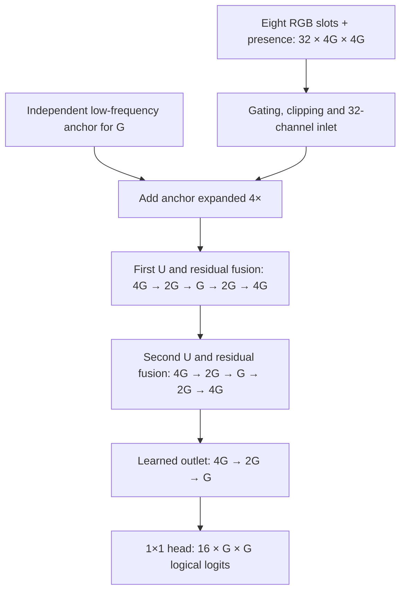
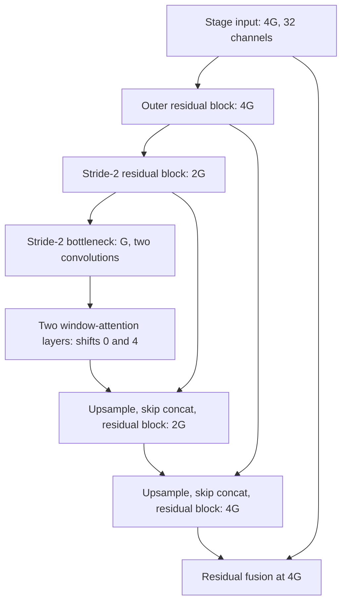
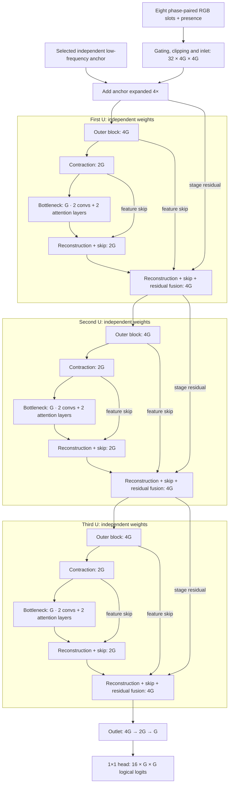
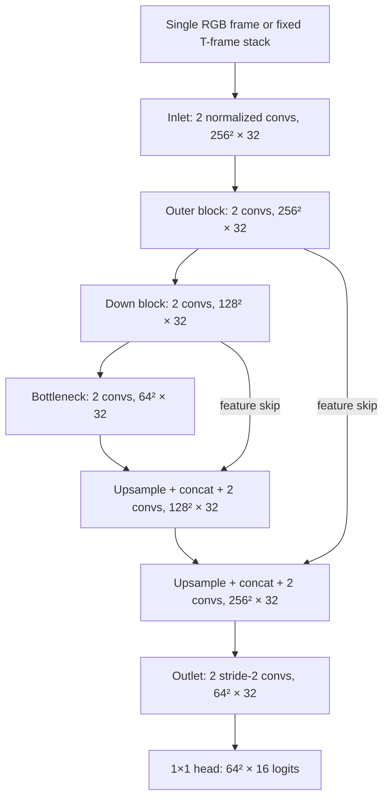
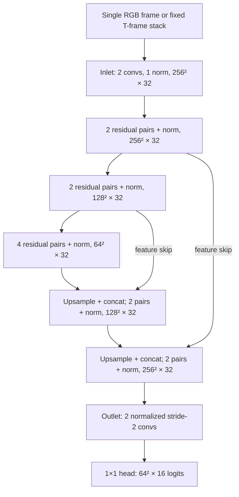
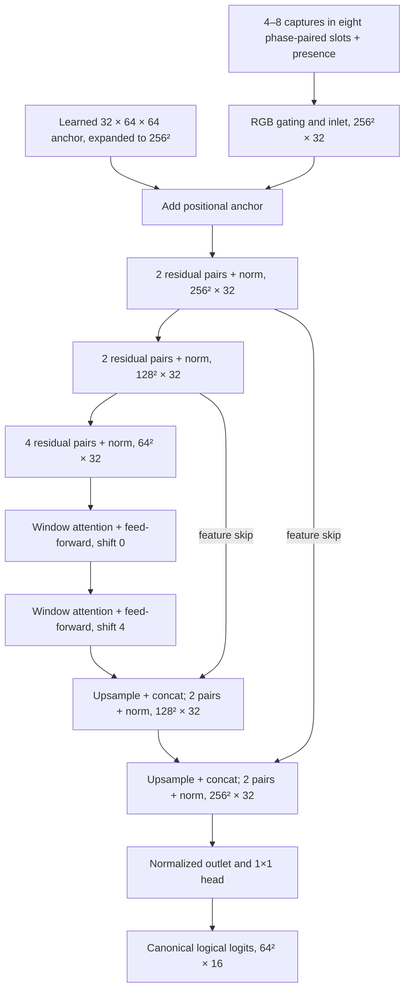
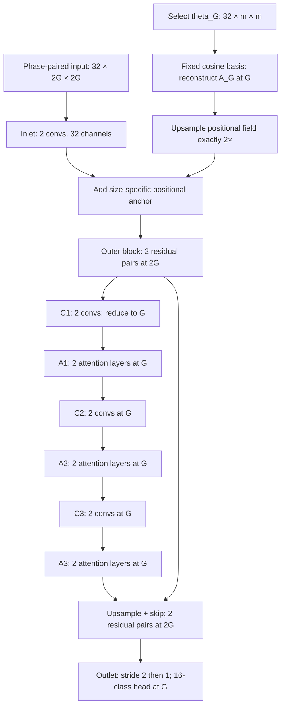

# Neural corrector: model family and architecture

> **Current collection:** Neural-QR v2 records G16/G32/G64/G128 at 4×4 pixels
> per cell with optical size cues. The [collection guide](MULTIRES_COLLECTION.md)
> describes this input contract. **W-tube and VW training and evaluation are implemented**
> for it. Their export and browser integration are separate remaining steps.
> The `multires` architecture below retains its prepared 2×2-cell experiment.

The **neural corrector** estimates a corrected optical matrix from one or more
camera observations. It learns to resolve color ambiguity, moiré, blur, lighting
variation and capture noise after the receiver has detected and rectified the
matrix. Its output is a score for every palette class at every matrix cell.
The receiver can turn those scores into a corrected color matrix or pass the
soft evidence to its existing byte decoder and error-recovery code.

These are separate responsibilities: the corrector predicts symbols; the
transport decoder interprets symbols as bytes and checks CRC/Reed–Solomon
constraints. The network receives neither expected payload bytes nor secret
cryptographic material. Corrected appearance or high confidence alone never
accepts a payload.

See the [capture and training guide](NEURAL_CORRECTOR_TRAINING.md) for dataset
commands, the [experiment README](../experiments/neural-corrector/README.md) for
entry points, and the [Corrector Lab guide](CORRECTOR_LAB.md) for exporting and
serving a trained model.

Original Neural-Corrector code and documentation use [Apache-2.0](../LICENSE),
with credit to Neural Cryptography and **Alejandro Hernandez Ruiz (magnux)** in
[NOTICE](../NOTICE). See [licensing scope](LICENSING.md) for model releases.

The next optical transport is [Neural-QR](NEURAL_QR.md). Its implemented collector acquisition
replaces the current separately decoded header with geometric anchors and phase
cues while reusing the palette, phase grouping and logical-label conventions. The
header-based descriptions below document the currently implemented OBM5 path;
they are not used by the new Neural-QR collector. Its current cue-based acquisition
and public-code session association are documented in [the collection guide](MULTIRES_COLLECTION.md).

The four-pixel multi-resolution models are **`W-tube`** with two complete U
stages and **`VW`** with three. Both use independent low-frequency anchors at
G16/G32/G64/G128 and four-phase K4–K8 inputs. VW adds a full third spatial
contraction/reconstruction path, including its own bottleneck and feature skips.
See the [W-tube](#w-tube) and [VW](#vw) architectures and
[training commands](NEURAL_CORRECTOR_TRAINING.md#train-vw). Browser performance
and real-device accuracy remain to be measured after training.

The separate two-pixel training model is **`multires`**, with a shared convolution/attention trunk and
an independent low-frequency positional anchor for every supported size, G8…G256.
Its bottleneck has six alternating blocks: convolution → attention → convolution
→ attention → convolution → attention. Each block contains two layers of its kind.
See [multires architecture](#multires-architecture). Its model, paired synthetic
generation, training, held-out evaluation and selected-size ONNX export are
implemented. A trained multires checkpoint and browser integration remain to be
validated. It uses **2×2 pixels per cell (four pixels total)**; the U-tube
experiments keep their established 4×4 contract.

## Currently implemented input and output contract

Let **G** be the matrix width in cells, **T** a fixed number of observations,
**K** the number of available observations in a variable input, and **N** the
batch size. A U-tube, W-tube or VW rectified crop has four pixels per cell along each axis: a G64
matrix produces a 256×256 RGB crop. Multires uses two pixels per cell, so G64
produces a 128×128 crop. The crop includes the colored reference
grid; it does not include the full camera image or monochrome transport header.
The four pixels per cell describe this **stored raster**, not the number of
independent camera pixels that observed each cell. Capture provenance records a
separate projected camera-pixels-per-cell estimate. W-tube synthetic generation
uses that estimate to match physical sampling scale before returning to the
fixed stored raster; see [camera-scaled corruptions](W_TUBE_DATA.md#camera-scaled-coherent-corruptions).
Detection, header validation, rectification and color calibration remain outside
the network.

| Input form | Models | Input tensor | Observation rule |
| --- | --- | --- | --- |
| Single frame | U-tube, U-tube-2x | `[N,3,4G,4G]` | One rectified observation |
| Fixed frame burst | U-tube, U-tube-2x | `[N,3T,4G,4G]` | T distinct observations of the same logical matrix and palette phase; T=1…64 |
| Phase-grouped burst | U-tube-2x-attn | `[N,32,256,256]` | Eight phase-paired RGB slots plus eight presence planes; K=4…8 |
| Multi-resolution phase burst | multires | `[N,32,2G,2G]` | Same phase slots and presence planes; G8…G256, K=4…8 |
| Full-resolution multi-resolution phase burst | W-tube, VW | `[N,32,4G,4G]` | Same phase slots and presence planes; G16/G32/G64/G128, K=4…8 |

Every model produces **`logits: [N,16,G,G]`**. These are unnormalized class
scores, not a rendered RGB image. Softmax over the active palette produces
per-cell probabilities; argmax produces one discrete symbol per cell. Preserving
probabilities allows the byte decoder to use uncertainty during error recovery.
The corrected logical data matrix is the common external result, although the
models use two internal label conventions:

- **U-tube and U-tube-2x** predict physical displayed palette classes. The
  receiver uses the validated phase header to reverse that palette mapping.
- **U-tube-2x-attn, multires, W-tube and VW** predict canonical, phase-zero logical data classes directly.
  Their output must not undergo another phase reversal.

Reference-grid cells occupy positions in the output tensor but are excluded from
payload scores and the supervised loss. The current fixed-frame models support
G64/G128 and 4/16 colors. The phase-grouped model is specifically G64, 16 colors,
four permuted phases. Structural G128 export support does not demonstrate that
weights trained on G64 recognize G128 captures; train and validate each size.

### RGB normalization

For calibrated RGB value `c` in camera-byte units, stored crop conversion is:

```text
stored = clip(c / 127.5 - 1, -1.5, 1.5)
network RGB = clip(stored, -1, 1)
```

Color correction may overshoot the original byte range. The wider storage bound
preserves that evidence in existing recordings. All models apply the same final
`[-1,1]` clamp before learned processing, for both real and synthetic inputs;
that clamp is part of the exported ONNX graph. Presence planes are binary flags,
not RGB values. The fixed-frame stack order is `R0,G0,B0,R1,G1,B1,...`.

## Architecture design

**U** refers to the U-Net path: spatial reduction gathers context, spatial
expansion reconstructs fine features, and skip connections retain evidence from
corresponding resolutions. **Tube** refers to the constant **32 output channels
per resolution block**. Concatenating a skip temporarily creates 64 channels,
which the receiving block reduces to 32; the inlet and final 16-class head are
also exceptions to the internal width.

The full-resolution rule is central to this family:

1. The inlet and outer U operate at the entire rectified crop resolution, **4G**.
2. The U bottleneck is **G**, exactly the target matrix resolution.
3. The reconstruction path returns to **4G** before the outlet reduces features
   through **2G** to **G**.

For G64 this is a **256→128→64→128→256** U, followed by a **256→128→64** outlet.
For a separately trained G128 fixed-frame model, it is a
**512→256→128→256→512** U, then **512→256→128**. The architecture does not add
coarser-than-cell stages. Payload symbols are effectively random, so preserving
local measurements is more useful than assuming large semantic image structures.
This is a design choice supported by the experiments, not a claim that all
coarser processing is mathematically incapable of helping.

All spatial convolutions use 3×3 kernels with padding one. The first convolution
of each downward transition has stride two. Reconstruction uses nearest-neighbor
upsampling followed by skip concatenation. The outlet has two normalized
stride-two convolutions, and the final head is a 1×1 convolution from 32 channels
to 16 logits. There is **no direct RGB shortcut to the output**: skip connections
carry learned feature streams.

`ChannelLayerNorm` computes mean and variance across the 32 channels separately
at each spatial location, with learned channel scale and bias. It neither
normalizes across spatial positions nor uses batch statistics or running
averages. Consequently, one example's activations do not depend on the other
examples in its minibatch. Its explicit arithmetic exports as ordinary ONNX
operations.

## Implemented architectures

| Profile | Main 3×3 convolutions per outer block / bottleneck | Additional components | Parameters |
| --- | --- | --- | --- |
| `U-tube` | 2 / 2 | Channel normalization after each convolution | `140112 + 864T`; 144,432 at T=5 |
| `U-tube-2x` | 4 / 8 | Residual pairs; one normalization per resolution block | `275472 + 864T`; 279,792 at T=5 |
| `U-tube-2x-attn` | 4 / 8 | Learned positional anchor and two window-attention blocks | 432,848, fixed eight-slot capacity |
| `W-tube` | 4 / 2 within each of two full U stages | Four attention layers overall; four independent low-frequency anchors | 454,992 processing + 32,768 anchors = **487,760** |
| `VW` | 4 / 2 within each of three full U stages | Six attention layers overall; the same four independent low-frequency anchors | 663,632 processing + 32,768 anchors = **696,400** |

The default profile is `U-tube`. The successful four-phase experiment uses
`U-tube-2x-attn`. A checkpoint identifies its own profile and input contract;
changing the command-line name does not convert weights into another architecture.

### W-tube

W-tube uses four rectified pixels per cell along each axis and repeats the
complete U computation. Its supported targets are **G16, G32, G64 and G128**.
Both bottlenecks have spatial size **G**, so neither stage reduces the random
symbol grid below its target resolution. Every learned feature block outputs
32 channels; skip concatenations temporarily have 64 channels.

The model first gates unavailable RGB slots with their presence flags, clips
available RGB to `[-1,1]`, and processes the packed tensor through the normalized
inlet. It adds the selected grid's positional anchor there. Two independently
parameterized U stages then refine these features. Residual fusion carries
full-resolution features across each stage. Only the final outlet reduces the
result to the target grid and produces sixteen logical-class logits.



Each U stage has its own weights and its own encoder-to-decoder feature skips.
Its outer, intermediate and reconstruction blocks each contain four main
convolutions (two residual pairs), followed by one channel normalization.
The bottleneck contains one residual pair and its normalization:



Each bottleneck attention pair uses four heads and 8×8-cell windows. The second
layer shifts windows by four cells, with the existing boundary mask preventing
wraparound attention across opposite image edges. There are **two bottleneck
convolutions and two attention layers per U**, rather than six alternating
bottleneck blocks. Computation is distributed over two complete resolution
paths, which retain and revisit high-resolution camera evidence.

At each U exit, fusion is
`ReLU(ChannelLayerNorm(stage_input + reconstructed_features))`. Both terms are
learned 32-channel features at 4G. The inlet has two convolutions with one final
normalization; the outlet has two normalized stride-two convolutions. The exact
parameter count is **487,760**, comprising **454,992 processing parameters** and
**32,768 anchor coefficients**. This count does not bound activation memory:
G128 processes 512×512 features through both U stages.

For each G, the anchor owns `[1,32,16,16]` learned cosine coefficients. The same
orthonormal synthesis and `G/16` scaling used by
[multires anchors](#independent-low-frequency-positional-anchors) reconstruct a
`[1,32,G,G]` field. W-tube enlarges it **4×**, adds it once after the inlet, and
lets both stages process that anchored feature stream. All four coefficient
tensors are independent even though their shapes match. The frequency limit
applies only to the positional prior; the input and output can retain arbitrary
cell-scale patterns.

| Target | Input crop | First and second U | Final outlet |
| --- | --- | --- | --- |
| G16 | 64×64 | 64 → 32 → 16 → 32 → 64 | 64 → 32 → 16 |
| G32 | 128×128 | 128 → 64 → 32 → 64 → 128 | 128 → 64 → 32 |
| G64 | 256×256 | 256 → 128 → 64 → 128 → 256 | 256 → 128 → 64 |
| G128 | 512×512 | 512 → 256 → 128 → 256 → 512 | 512 → 256 → 128 |

The current release supports PyTorch training, evaluation and strict W-tube
checkpoint loading. Start W-tube from scratch; the two-pixel multires and earlier
U-tube checkpoints have different architectures. Continuing a W-tube run uses
`--initialize` with a W-tube checkpoint and a new output directory. Exported
ONNX graphs and browser latency/parity are a separate milestone, so this model
is not yet selectable in the live demo.

All four grids are structurally supported, but a run updates only the anchors
for grids sampled during training. Checkpoint `trainedSizes` records those grids;
an untouched anchor is not evidence of a trained corrector at that resolution.

### VW

VW adds **one complete U stage** to W-tube. The three stages have independent
weights and each follows **4G → 2G → G → 2G → 4G**, with its own bottleneck,
encoder-to-decoder skips and normalized residual fusion. Each bottleneck keeps
the W-tube design: **two residual convolutions followed by two attention layers**,
using 8×8 windows with shifts zero and four. VW therefore has three bottlenecks
and six attention layers overall. It does not add extra conv/attention cycles
inside the existing bottlenecks.

The added path lets the model revisit full-resolution camera evidence after a
third round of context aggregation. All three bottlenecks remain at **G×G**;
no stage reduces the representation below the target cell grid. Every block
still outputs 32 channels, and each skip concatenation temporarily creates 64.
The diagram shows every contraction/reconstruction path, its local feature skips,
and the full-resolution residual passed around that stage:



Each reconstruction node upsamples, concatenates its local encoder skip and
applies the same four-convolution residual block as W-tube. The 4G node then
fuses its stage input as
`ReLU(ChannelLayerNorm(stage_input + reconstructed_features))`.
There is no raw RGB shortcut or cross-stage weight sharing. The selected
positional anchor is added **once after the inlet**, rather than once per U.

| Property | W-tube | VW |
| --- | ---: | ---: |
| Complete U stages / target-sized bottlenecks | 2 | 3 |
| Main 3×3 convolutions, including inlet/outlet | 40 | 58 |
| Window-attention layers | 4 | 6 |
| Processing parameters | 454,992 | 663,632 |
| Independent anchor coefficients | 32,768 | 32,768 |
| Total parameters | 487,760 | **696,400** |

For G128, **each** U traverses 512 → 256 → 128 → 256 → 512. The added stage
increases both high-resolution computation and activation memory; parameter
count alone is not a latency or VRAM estimate. This is a test of greater depth
and spatial context, not evidence that obscured or undersampled captures are
recoverable.

The input/output contract, recordings, prepared W-tube datasets, sampling,
augmentations and optional RS-aware loss are unchanged. Start the VW experiment
from fresh weights using [these commands](NEURAL_CORRECTOR_TRAINING.md#train-vw).
Its checkpoints record `modelProfile: "VW"` and three stages; a W-tube checkpoint
does not silently become VW. Continue a VW run with another VW checkpoint and
a new output directory. PyTorch training/evaluation and strict checkpoint loading
are implemented; ONNX export, browser parity and live reception remain separate
work, as for W-tube.

### U-tube

This is the smallest full-resolution model. Its inlet contains two
Conv→ChannelLayerNorm→ReLU stages. Each of the five U resolution blocks contains
two such stages; the outlet contains two more. There are 14 main 3×3 convolutions
in total, followed by the 1×1 class head.



At T=1 it has **140,976 parameters**; at T=5, **144,432**; at T=8,
**147,024**. Only the RGB-facing inlet width changes with T. Fixed bursts combine
captures from one palette phase, so the output labels describe that phase's
physical displayed colors.

### U-tube-2x

This profile increases transformation depth while retaining the same spatial
path and 32-channel block outputs. Each outer block has **two residual pairs**
(four main convolutions); the bottleneck has **four residual pairs** (eight).
Each pair computes:

```text
ReLU(shortcut(x) + Conv3×3(ReLU(Conv3×3(x))))
```

The shortcut is an identity within a resolution. A 1×1 projection handles stride
changes or the 64-channel skip concatenation. One ChannelLayerNorm followed by
ReLU sits after the complete resolution block, rather than after every residual
convolution. The inlet still has two convolutions, with normalization after the
second; both outlet stages remain normalized.



The `2x` name describes the **28 main 3×3 convolutions** versus 14 in U-tube;
shortcut projections and the output head are additional. It does not mean twice
the channels or exactly twice every block's depth. At T=1 it has **276,336
parameters**; at T=5, **279,792**; at T=8, **282,384**.

### U-tube-2x-attn

This profile retains the residual convolutional path and adds two mechanisms:

- A **learned global positional anchor** of shape `[1,32,64,64]`, initialized
  with standard deviation .02. Bilinear interpolation expands this tensor to
  256×256, and it is added immediately after the inlet. The anchor is an
  independently learned coordinate reference; it is neither an observed image
  nor a fixed sinusoidal encoding. It contributes 131,072 parameters while the
  image features continue to be processed at full resolution.
- **Two window-attention blocks** after the 64×64 convolutional bottleneck.
  Each uses 32 channels, four heads, 8×8-cell windows, Q/K/V and output linear
  projections, and a 32→64→32 feed-forward network. Each attention and feed-forward
  sublayer has pre-normalization and a residual addition. The second block shifts
  its windows by four cells to communicate across the first partition's borders.



The parameter total is **432,848**: the eight-RGB-frame residual body (282,384),
eight extra presence channels at the inlet (2,304), the anchor (131,072), and
two attention blocks (17,088). The graph uses ordinary convolution, normalization
arithmetic, linear projections, MatMul, Softmax, reshape and resize operators.
Its fixed 64-cell window geometry and learned anchor currently restrict it to
G64. A future G128 attention corrector needs its own explicit design and training.

## Burst and phase assembly

Fixed bursts randomly select distinct captures within one recorded burst during
training. Evaluation fixes a seeded shuffle before forming nonoverlapping groups;
it does not select consecutive frames by default. Sources, sessions, payloads
and phases never get mixed in a fixed burst.

The phase-grouped profiles (`U-tube-2x-attn`, `multires`, `W-tube`, and `VW`) use these
fixed slot meanings:

| Phase | RGB slots | Logical-to-physical data-symbol XOR |
| --- | --- | --- |
| 0 | P0a, P0b | 0 |
| 1 | P1a, P1b | 15 |
| 2 | P2a, P2b | 7 |
| 3 | P3a, P3b | 8 |

A group must describe one logical matrix in one physical session. Every phase
supplies one or two observations. Training chooses K uniformly from 4–8,
randomly chooses which phases supply the extra K−4 observations, and randomizes
placement within each pair. Training pools need two captures per phase to make
all counts available, although an individual input may use only one. Live K4
inference requires one capture from every phase, not four arbitrary camera frames.

The first 24 input planes hold RGB in the eight slots; the last eight planes are
the presence flags explained below. Input shape and computational work remain
fixed even at K4. Fewer captures can reduce collection time, but do not halve
network inference cost.

The palette XOR affects **data cells only**; references retain their known
physical colors. Supervision reverses the XOR on data labels to make one
canonical target. It does not attempt to recolor noisy RGB inputs. Acquisition
obtains phase identity from the public header in the OBM experiment or the
repeated phase cues in Neural-QR, so no sender truth is required at inference.

Four exact phase permutations augment training. Choose d from `[0,15,7,8]`,
reorder phase pairs so the old mask equals the new mask XOR d, move their
presence flags with them, and XOR only the data labels by d. Joint horizontal
and vertical flips then transform every RGB observation, label and data-cell
mask together, with default probability .25 per axis. Neither transformation
is applied to stored recordings or ordinary validation. Transformed targets are
classification examples; they must be returned to original coordinates and
label space before any comparison with the original CRC-protected bytes.

Synthetic phase groups share slow optical conditions while motion, moiré,
rolling-shutter timing, exposure drift and noise evolve along one trajectory.
They are not four unrelated corruptions of separately sampled matrices.
The training guide describes the real/synthetic pairing and source/direction
balance.

## Masks and the training objective

Four different mechanisms are called masks in this pipeline. They control
different axes and must not be interchanged.

### Input presence mask: which observations exist

The three phase-grouped profiles have an observation-presence mask: **eight binary
flags per example**, broadcast to the input crop's spatial size. That is 256×256
for U-tube-2x-attn, 2G×2G for multires and 4G×4G for W-tube/VW. A present
slot has flag one; an absent slot has flag zero and normally contains zero RGB.
The model multiplies each RGB triplet by its flag before the inlet, then supplies
the same flags as input channels. This makes missingness explicit: a zero RGB
value could otherwise be an ordinary normalized mid-gray measurement.

Presence is not inferred from image brightness, class confidence, labels or
successful CRC recovery. It describes capture availability only. Real color/noise
augmentation happens before padding; it never adds noise to flags or missing
RGB slots. Phase permutations move flags and RGB together. Within each phase
pair at least one flag must be one. The four phase pairs therefore contain 4–8
actual observations in total.

### Loss mask: which output cells carry data

The spatial loss mask has shape **`[N,G,G]`**. It is one for data cells and zero
for the known color-reference grid. The monochrome header lies outside this
crop, so it has no entries in this mask. The mask comes from the public grid
layout, not from whether a cell was easy to recognize or the classical decoder
succeeded. Hard data cells remain in the objective.

For example i with D_i data cells, the default supervised loss is:

\[
L_i = \frac{1}{D_i}\sum_{x,y} M_i(x,y)\,
       \operatorname{CE}(z_i(x,y), y_i(x,y)),\qquad
L = \frac{1}{N}\sum_i L_i.
\]

Thus examples receive equal weight after averaging their own data cells. Reference
logits do not contribute to loss or payload recovery. **Reference RGB remains
visible to the network**, so reference observations can still provide useful
color/context evidence and affect gradients through data-cell predictions.
Excluding a reference from loss does not erase it from the input. A spatial flip
moves the loss mask together with the targets; a phase permutation leaves its
positions unchanged.

Sixteen-color Neural-QR training also supports an optional
[RS-aware weighted CE](NEURAL_CORRECTOR_TRAINING.md#rs-aware-weighted-cross-entropy).
It retains this data-cell mask and equal example weighting, while emphasizing
blocks near the RS error budget. Two flip flags per example restore canonical
byte order for the weighting calculation; input and phase augmentations remain
enabled. Ordinary CE is still reported separately from that training objective.

### Active-class mask: which palette entries are legal

The head always has 16 channels. A four-color fixed-frame example uses only the
first four channels in cross-entropy, softmax and hard classification; the other
12 are excluded. A 16-color example uses all channels. This is a restriction on
the **class axis**, independent of the spatial data-cell mask. Merely zeroing
unused logits would be incorrect because zero can still receive softmax mass;
the implementation slices to the active palette before computing the loss and
probabilities.

### Shifted-window attention mask: which positions may communicate

The second attention block uses a cyclic shift to change the window partition.
Without a boundary mask, that implementation would falsely place opposite image
edges next to one another. A fixed additive mask inserts a large negative value
into disallowed attention scores before Softmax, preventing that wraparound.
It does not mark missing captures or remove difficult cells from training. It is
not a learned parameter and does not change the supervised target.

## Training sampling

W-tube and VW use one grid per optimizer update, equal paired real
and synthetic counts, and balanced available acquisition directions. The default
first draws a recording origin with global shares of 50% native, 35% resampled
and 15% header-G64, then chooses a grid uniformly among that origin's available
grids. `--origin-ratios` sets those shares explicitly; a positive share for a
missing origin is rejected. Synthetic partners retain the real sample's origin
and target. The policy is applied before gradient accumulation is divided into
microbatches. The separate `--native-real-fraction` option selects an alternative
uniform-grid, within-grid native quota. See
[the sampling policy](NEURAL_CORRECTOR_TRAINING.md#w-tube-sampling-policy) for
coverage gaps, stochastic rounding and the effective-batch example.

## Evaluation and current evidence

Evaluation reports cell cross-entropy and cell error rate. The OBM experiment
also reports exact payload recovery through the classical byte decoder. Neural-QR
multires, W-tube and VW instead report exact logical data matrices, since their
training symbols have no packet/CRC envelope. Both classical fusion and
the neural corrector receive the same actual captures. Phase-grouped evaluation
uses nested K4/K5/K6/K7/K8 subsets of fixed shuffled phase pairs, so all five
presets have the same logical candidates. The candidate count is not multiplied
by five when describing the amount of independent held-out data.

W-tube and VW give fresh native real captures priority in validation: if native
candidates exist, headline metrics and checkpoint selection use that population.
The report retains native, resampled and header-G64 as separate table dimensions
and derives origin summaries without pooling them into the native headline.
Without native candidates, the population is explicitly `auxiliary-only`.
These origin distinctions describe where the evidence came from, not whether a
model successfully classified it. No validation origin enters the model input.
Default history/evaluation files use lean canonical tables rather than repeated
grid/group/source/K trees; full-precision metrics still drive checkpoint
selection. See [report files](NEURAL_CORRECTOR_TRAINING.md#metrics-and-report-files).

The reported 32,000-update phase-grouped run reached:

| Captures | Overall exact recovery | Phone→PC exact recovery | PC→phone exact recovery |
| --- | --- | --- | --- |
| K4 | 98/112 = 87.50% | 34/48 = 70.83% | 64/64 = 100% |
| K5 | 101/112 = 90.18% | 37/48 = 77.08% | 64/64 = 100% |
| K6 | 106/112 = 94.64% | 42/48 = 87.50% | 64/64 = 100% |
| K7 | 112/112 = 100% | 48/48 = 100% | 64/64 = 100% |
| K8 | 112/112 = 100% | 48/48 = 100% | 64/64 = 100% |

These counts are reconstructed from the supplied rounded console output and its
known evaluation grouping. The aggregate is **529/560 = 94.46%** observation
cases, with validation CE **0.0198** and cell error **0.64%**. There are **112
shared logical candidates**, not 560 independent matrices. The final selected
score of **93.54%** averages directions equally and then capture counts; it
therefore differs legitimately from the sample-weighted aggregate above.

This meets the earlier phone→PC recovery target on the recorded validation set.
Those validation measurements alone do not measure fresh-camera recovery,
browser inference latency or optical goodput. The subsequent live device
exchange is described below.
The changes combined phase evidence, architecture, augmentation and additional
sessions, so this run does not isolate the contribution of each change.

## multires architecture

The architecture name is **`multires`**. Share convolution, normalization,
attention and classifier weights across G = **8, 16, 32, 64, 128, 256**, but
give each size its own independently learned anchor. Use **2×2 rectified pixels per cell**, four
pixels total. The U runs through **2G → G → 2G**, and its outlet reduces **2G → G**.
The bottleneck never goes below the target symbol resolution. Phase-grouped
input becomes `[N,32,2G,2G]`; output remains `[N,16,G,G]`, with four to eight
observations in the same eight phase-paired slots.

| Matrix G | Rectified crop | 8×8 attention windows per block | Approximate work relative to G64 | Raw 16-color capacity, before any overhead |
| --- | --- | --- | --- | --- |
| 8 | 16×16 | 1 | 1/64 | 32 B |
| 16 | 32×32 | 4 | 1/16 | 128 B |
| 32 | 64×64 | 16 | 1/4 | 512 B |
| 64 | 128×128 | 64 | 1 | 2,048 B |
| 128 | 256×256 | 256 | 4 | 8,192 B |
| 256 | 512×512 | 1,024 | 16 | 32,768 B |

The work column compares sizes of this new 2×2-cell design, not the previous
4×4-cell model. It is an area-scaling estimate, not a measured latency promise.
Window attention keeps 64 tokens per window; larger grids add windows, rather
than attending globally across every cell. Convolution and attention work scale
approximately as G² with fixed widths and window size. Parameters can remain
shared in the trunk, but the separate anchors increase the total count as shown
below. Activations also grow: one float32 `[1,32,512,512]` tensor alone is
32 MiB. At G256 one four-head attention-score tensor is another 64 MiB, before
other intermediate tensors. G256 therefore
needs device memory and latency measurement even if its model file is small.

### Independent low-frequency positional anchors

Each grid owns a separate learned coefficient tensor `theta_G` shaped
`[1,32,m,m]`, where **m = min(G,16)**. Equal coefficient shapes at G16 and above
do not share weights: selecting G128 selects the G128 coefficients, never a
resized G64 parameter. The coefficients reconstruct a G×G positional field,
which is then enlarged **exactly 2× per axis** and added after the inlet.

Let `Q_G` contain the first m columns of the orthonormal DCT-II synthesis basis,
with shape `[G,m]`. For each feature channel:

$$
A_G = \frac{G}{m} Q_G\theta_G Q_G^\mathsf{T},\qquad
\text{features} = \text{inlet}(\text{pixels}) + \text{upsample}_{2\times}(A_G).
$$

`Q_G` is fixed geometry, not learned state. The **G/m** multiplier makes the
mean squared spatial anchor equal to the mean squared coefficients. Initializing
all coefficient tensors with standard deviation .02 therefore gives comparable
expected spatial RMS at every size, without progressively shrinking large-grid
anchor updates. The basis is evaluated with real matrix multiplications; training
does not need an FFT package or complex tensors.

Only modes 0…m−1 along each axis are present. G8/G16 retain their full spatial
basis; larger grids have a strict low-frequency positional prior. This limits
position-specific memorization capacity while preserving independent size
conditioning. It does **not** smooth the camera evidence, attention features or
output logits: those streams can still represent sharply changing random data
symbols. The anchor is part of the model, not an optical corner marker or a
camera-derived calibration map.

### Six alternating bottleneck blocks

The one-level U retains the full-resolution inlet and outer block `e0`, the
bottleneck, reconstruction block `d0`, outlet and head. Its bottleneck is:

| Block | Layers | Spatial size | Residual / normalization |
| --- | --- | --- | --- |
| C1 | Two convolutions | 2G → G | Learned stride-two shortcut, one channel normalization |
| A1 | Two window-attention layers | G | Shifts 0 / 4; each layer retains its own norms |
| C2 | Two convolutions | G | Identity shortcut, one channel normalization |
| A2 | Two window-attention layers | G | Shifts 0 / 4 |
| C3 | Two convolutions | G | Identity shortcut, one channel normalization |
| A3 | Two window-attention layers | G | Shifts 0 / 4 |

Thus **six blocks means six main convolutions and six attention layers**. A
convolution block is one residual pair, not two residual pairs. Only C1 reduces
resolution; every subsequent block stays at the target grid G. The three
attention pairs have independent parameters, 32 channels, four heads and
8×8-cell windows. At G8, all shifts and wraparound masks are disabled because
one window covers the entire grid; all six attention layers still execute.



The attention boundary mask is derived for the selected grid and partitioned
into G/8 windows per axis. Presence planes still express exactly eight
availability flags; only their spatial extent changes. The spatial loss mask
follows the actual reference grid at each size, never an interpolated G64 mask.
The Python model parameterizes RGB packing, anchor reconstruction, attention
geometry and tensor validation together. The existing browser contract remains
specific to the established U-tube demo until its separate Neural-QR integration.

### Parameter counts and model capacity

The six coefficient tensors contain **43,008 trainable parameters**:
`32 × (8² + 5 × 16²)`. The shared processing trunk has **231,120 parameters**,
for a combined training model of **274,128 parameters**. Its third convolution
block adds 18,560 parameters and its third attention pair adds 17,088.

| Profile | Learned coefficient grid per channel | Selected anchor coefficients | Shared trunk + selected coefficients |
| --- | --- | --- | --- |
| G8 | 8×8 | 2,048 | 233,168 |
| G16 | 16×16 | 8,192 | 239,312 |
| G32 | 16×16 | 8,192 | 239,312 |
| G64 | 16×16 | 8,192 | 239,312 |
| G128 | 16×16 | 8,192 | 239,312 |
| G256 | 16×16 | 8,192 | 239,312 |

These are **trainable parameter counts**, not complete ONNX file sizes. Fixed
bases, geometry masks and a reconstructed deployment anchor are not trainable
coefficients. The processing trunk stays below the approximate 500k parameter
guideline. The frequency cap controls statistical capacity; adding the third
convolution/attention pair increases computation and activation memory, so the
smaller checkpoint does not imply faster inference.

### ONNX/WASM deployment

Use **one trained checkpoint with static-shape exports**, loaded on demand. Each
profile shares the same trained trunk and selects its own learned anchor. A
trained checkpoint can export only grids listed in its `trainedSizes`; this
prevents presenting an untouched anchor as a trained profile.

For export, reconstruct the selected G×G anchor once and put that spatial field
in an **export-only copy**. The training model retains its differentiable
coefficient tensors. The ONNX graph contains the selected reconstructed anchor,
followed by its existing 2× Resize and addition. It contains no FFT/DCT operator,
no other size's anchor, and no trainable coefficient bank. The rest of the graph
uses ordinary Conv, channel-normalization arithmetic, Resize, MatMul and Softmax.

Baking the anchor does not preserve the compressed coefficient storage in the
ONNX file. The G256 spatial anchor alone occupies 8 MiB in float32; pre-expanding
it to the 512×512 inlet would occupy 32 MiB and is deliberately avoided. Constant
shifted-window masks and graph metadata add further storage. Inspect actual
exported byte counts rather than estimating the bundle from training parameters.

Keep numerical parity checks enabled for each export. Graph/parity tests on
public untrained fixtures establish execution agreement, not camera recognition
or phone latency. Browser loading and live Neural-QR packet integration still
require the corresponding contract update and real-device measurements.

On 5 November 2026, native ONNX Runtime passed two public fixtures each at G8,
G16, G64 and G256, with maximum absolute logit error 2.21×10⁻⁶ and zero changed
argmax cells under the unchanged parity tolerances. This was an **untrained
numerical check**, not a measurement of real capture accuracy or new browser
WASM performance. The static ONNX files measured:

| Profile | ONNX bytes |
| --- | ---: |
| G8 | 1,024,907 |
| G16 | 1,269,547 |
| G64 | 4,710,190 |
| G256 | 59,760,451 |

The additional shifted-attention layer increases constant geometry-mask storage
at G256. The exported file can therefore grow while the trainable parameter
count falls; anchor compression and attention-mask representation address
different costs.

### Training and transport integration

Train one model across sizes, retaining G64 examples. Fresh initialization is
the default; `--initialize` also supports an explicit warm start from the
successful G64 U-tube-2x-attn checkpoint. Copy matching shared layers and project
its G64 spatial anchor into the retained cosine modes; initialize other size
coefficients and unmatched layers independently. Other anchors are never made
by resizing the G64 tensor. Removed encoder/decoder blocks have no destination.
This is an explicit training initialization, not an exact checkpoint resume.

The current `multires` checkpoint requires the low-frequency anchor and six-block
bottleneck metadata. Dense-anchor/four-block multires checkpoints from the
previous experiment do not load into this architecture. Keep those runs with
their source revision; start the revised model in a new output directory. The
recorded datasets and generated synthetics are unchanged and can be reused.

For this separate two-pixel experiment, use one size per optimizer update and select active resolutions uniformly.
Keep microbatches small enough for G256 instead of padding every example to
512×512; gradient accumulation increases the effective batch. Keep per-example loss normalization so large matrices do
not dominate merely by having more labeled cells. Generate synthetic observations
at each actual cell density and evaluate real capture recovery by size. Use the
existing prepared 2×2-cell datasets for this model. The current collector writes
4×4-cell version-2 recordings for W-tube; it does not regenerate this experiment.
The explicit offline importer converts eligible earlier recordings into the
separate W-tube corpus, not into the two-pixel multires dataset. The changed input
sampling means existing recovery rates do not transfer automatically.
A shape change alone does not demonstrate accuracy at unseen resolutions.
Training pairs real observations with synthetic versions of the same logical
matrix at `--real-fraction .5`. Generation defaults to 8 bursts × 8 captures ×
4 phases, or 256 synthetic captures per target. Dataset counts do not determine
the training source mixture. Validation uses fixed random, nonconsecutive phase
subsets and reports K4…K8 separately at each resolution. The primary exact
metric is the entire logical data matrix, excluding fixed reference cells;
these collection matrices contain no application packet or CRC/ECC envelope.

Training and validation reports separate real and synthetic metrics within each
resolution. Global `CER (cell)` pools all data cells, so larger matrices carry
more weight; `CER(size)` averages the represented per-grid CER values equally.
Neither changes the mean-per-example loss or the size/direction/K-balanced
checkpoint-selection objective. Compare real training with real validation at
the same grid, remembering that training metrics are interval averages with
augmentation, whereas validation is a fixed draw at the current checkpoint.

Only the selected coefficient tensor receives gradients from an update; all examples
update the shared trunk. Clear gradients with `set_to_none=True` so an inactive
anchor is not accidentally decayed or updated through stale optimizer gradients.

Neural-QR can then use small profiles for controls and large profiles for data.
The receiver must know G before rectification/inference. The current version-2
collector reads the repeated coarse optical size code and cross-checks the public
collection assignment; the packet receiver remains a future integration. The
learned positional anchor is internal to the model, distinct from optical corner
markers. Capacity must include reference cells, framing, ECC and integrity checks:
G8 has only 32 raw bytes and cannot automatically carry today's full ACK envelope.
Choose the smallest profile that actually fits the complete control message.

References: [ONNX Runtime Web](https://onnxruntime.ai/docs/tutorials/web/),
[dynamic dimension overrides](https://onnxruntime.ai/docs/tutorials/web/env-flags-and-session-options.html#freedimensionoverrides),
and [WebGPU graph capture](https://onnxruntime.ai/docs/tutorials/web/ep-webgpu.html#graph-capture).

## Browser integration and the next transport

The demo server serves static assets. Python loads the training `.pt` checkpoint
and exports the selected network to ONNX together with a manifest and numerical
fixtures. The browser downloads that exported bundle and runs ONNX Runtime Web
inside a worker. It does not load a PyTorch checkpoint or call a Python inference
endpoint. See the [explicit serving workflow](CORRECTOR_LAB.md).

The standalone Corrector Lab checks numerical parity and performs camera crop
inference. The separate [Neural-ZKBoo demo](NEURAL_ZKBOO_DEMO.md) now connects
corrected logical scores to packet recovery and the authentication session. The
4 November 2026 device exchange completed proof verification and final result
delivery using neural DATA reception and static QR ACKs. The Optical Bench's
other transport workspaces remain separate experiments.

The next step is [Neural-QR](NEURAL_QR.md): remove the dense external header,
use the shared multi-resolution 2×2-cell model, and carry both DATA and controls
through neural recovery. Initialize from existing weights and fine-tune for the
new sampling and sizes. Acceptance still requires packet integrity and context
checks; Neural-ZKBoo proof verification remains independent of transport recovery.
Measure exact recovery, acquisition, inference, ACK time and complete authentication
in both directions. A larger matrix or new architecture is not a prerequisite.

