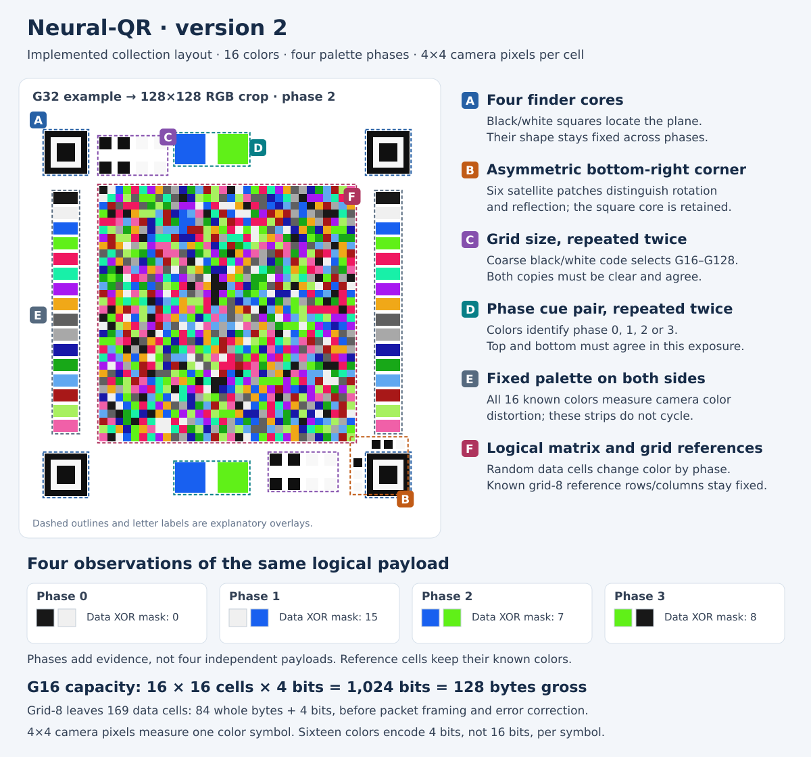

# Neural-QR: optical transport designed for a neural corrector

**Status: proposed next format, 4 November 2026.** Neural-QR is the project's
name for its custom optical matrices. It is not a standards-compatible QR code.
The design below is not yet the runnable wire format: the working
[Neural-ZKBoo demo](NEURAL_ZKBOO_DEMO.md) still uses OBM5 color DATA and standard
QR ACKs. Its successful device exchange is the baseline for the next implementation.

The goal is fast, reliable optical authentication, with Neural-QR carrying both
data and control messages, the **neural-corrector** recovering logical matrix
symbols, and **Neural-ZKBoo** checking the proof. Removing the separate dense
monochrome header should remove an acquisition bottleneck and free layout space.
It does not remove packet framing, error correction, or cryptographic verification.

## Proposed visual layout

The illustration uses a G32 sample for legibility. Cell colors are illustrative,
not an encoded valid packet. Marker dimensions and the asymmetric corner pattern
are design candidates. The outer geometry stays fixed across phases; only the
phase patches and phase-permuted data colors change. Reference colors stay fixed.

The target is a **multi-resolution family**, G8/G16/G32/G64/G128/G256, read by
**`multires`**: a shared convolution/attention trunk with one learned G×G anchor
per size, enlarged exactly 2× at its inlet. At G the bottleneck alternates
**2 convolutions → 2 attention blocks → 2 convolutions → 2 attention blocks**.
G64 is the existing trained starting point;
small controls and larger data matrices can use different profiles. The
[model design](NEURAL_CORRECTOR.md#multires-next-architecture)
specifies crop sizes, anchors, masks, export and training changes.
Rectification uses **2×2 pixels per cell**: G32 → 64×64, G64 → 128×128 and
G256 → 512×512. Drawing cell dimensions are illustrative display units, not
camera sampling pixels.

## Design boundaries

| Layer | Responsibility |
| --- | --- |
| Neural-QR geometry and optical cues | Locate and orient the image; identify a clear palette phase; measure color references |
| neural-corrector | Convert distinct captured frames into logical symbol scores |
| Error correction and packet parsing | Recover bytes; reject damaged or malformed packets; check session, message and sequence context |
| Neural-ZKBoo | Verify the existing proof against the pinned public identity and fresh challenge |

Neural confidence is evidence for classification, not proof that bytes are exact.
CRC and Reed–Solomon recovery address channel errors, not a malicious sender.
The existing proof and authentication envelope remain the canonical crypto layer.

## Starting profile and shared multi-resolution model

Reuse the successful profile's **16 colors, four palette phases and grid-8
references**, with error correction sized to each packet profile. Both apps know
the directional grid sizes before scanning; no dense header is needed to discover
them. Preserve palette masks `(0, 15, 7, 8)`, logical-label output and phase pairing:
four to eight distinct exposures, at most two per phase. The new model takes
`2G×2G` RGB crops; its weights start from the trained G64 checkpoint and require
fine-tuning for the changed sampling and shared size family.

Preserve the reference-grid convention and measured color normalization. Retain
the G64/RS32 data profile as a comparison while adding smaller controls and larger
payloads; overhead and error-correction settings must fit each profile.
Reclaiming header space may enlarge displayed cells, but a fixed G64 symbol grid
does not automatically carry more bytes. The final renderer determines the gain.

## Geometry and orientation

Keep **four anchor locations**. Use three ordinary high-contrast finders and
replace the bottom-right finder with an **oriented asymmetric fiducial** whose
center can still be localized accurately. Its internal pattern must distinguish
handedness as well as rotation; merely making one corner a different square or
circle does not resolve every mirrored ordering.

Four point correspondences determine the planar perspective transform. Removing
a corner would require recovering additional constraints from marker edges or
the frame; three point correspondences alone determine an affine transform.
See the primary [OpenCV transform reference](https://docs.opencv.org/4.x/da/d54/group__imgproc__transform.html).

Keep finder contours black/white and unchanged through the phase cycle. The
colored phase cues sit in separate patches with clear spacing. This keeps
geometry detection independent of phase color, exposure shifts and palette noise.
Known ordered border references also provide an orientation consistency check.
Try recently validated geometry first, then reacquire when current cues disagree
or the geometry-age bound expires. Cached coordinates never supply old phase data.

## Phase cues without the dense header

Use large, repeated color patches measured against fixed palette references in
the **same exposure**. A concrete initial candidate is a pair of patches for
phase `p`: palette entries `(p, (p + 1) mod 4)`, using the four well-separated
entries at the start of the existing palette. Repeat that pair on the opposite
side of the frame. These cue colors are specified independently of the payload's
XOR phase permutation; the reference palette itself stays fixed.

Classify the pair after local reference correction, require an adequate margin
between candidate phases, and require the separated copies to agree. An uncertain
or inconsistent exposure is skipped. Top/bottom disagreement is useful evidence
of a display transition or rolling-shutter mixture. These are robust optical cues,
not a second byte-oriented header or an authentication mechanism.

This removes the current 512-bit header and its CRC as a prerequisite to entering
the model. It does **not** imply that every frame is usable, or that one patch's
nearest color is sufficient evidence of its phase. Test cue colors and thresholds
under blur, clipping, glare and camera color processing before freezing the layout.

## Packet boundaries and metadata

Place packet type, full session/message identifiers, sequence, length and packet
integrity checks **inside the ECC-protected color payload**. Fixed profile
geometry defines symbol packing and the ECC block layout before those fields are
read. Decode the complete fixed-size body, then validate its encoded length and
packet schema. Pad unused cells as in the current dense training distribution.
Keep full-message digest checks and current transfer matching above this layer.

The current receiver groups captures using identity read from the monochrome header.
Removing that header therefore requires an explicit replacement for burst
membership; phase labels alone do not identify a logical packet.

For the first implementation, retain **strict stop-and-wait** and a bounded pool
of the latest one or two distinct captures per phase. Reset after an accepted
packet and on run/geometry discontinuities; reject stale observations by age.
Old/new packet mixtures can occur during a transition, so failed recovery must
allow fresh observations to replace them. A repeated accepted packet can reproduce
its ACK but must not be delivered to the application twice. Only an ECC/CRC-valid
packet with matching full identifiers and sequence may advance the transfer.

Evaluate this transition behavior before adding simultaneous packet windows. A
small, coarse generation cue is an optional grouping aid if recovery stalls; it
must not replace the full in-band identifiers or become another dense header.
This is a design decision to test, not an already implemented grouping guarantee.

## ACKs and control messages

The shared multi-resolution corrector makes a **smaller Neural-QR control profile**
the preferred path. Select the smallest grid that fits the complete ACK plus
reference cells, framing, ECC and integrity checks. G8 carries only 32 raw bytes
at 16 colors before any overhead, so do not assume it can hold the present ACK.
Keep ACK binding to transfer, message, acknowledged sequence and digest.

Use the same four-phase, four-to-eight-capture contract initially; smaller grids
reduce neural computation without claiming that a single exposure is sufficient.
One shared model can serve small controls and large data after mixed-size training
and export. Until that integration is available, the G64 envelope can exercise the
same codec on both paths. Measure control acquisition, processing and physical-turn
latency directly rather than assuming that removing standard QR makes it faster.

After grouping is reliable, cumulative acknowledgments and selective retransmission
can reduce physical turns. Do not advance through unrelated packets on a timer
without retaining the receiver's missing-packet state.

## Acceptance tests and measurement

- Geometry: perspective, all rotations, reflection, partial occlusion and confusing
  background shapes. A tentative location is distinct from an accepted packet.
- Phase cues: same-exposure color correction, clipped colors, motion blur, glare,
  rolling shutter and frames spanning a phase transition. Uncertainty causes retry.
- Burst membership: skipped phases, repeated exposures, old/new packet mixtures,
  duplicate packets, camera motion, restart and expired samples. Buffers stay bounded.
- Bytes and authentication: exact delivered bytes, no damaged packet acceptance in
  the test set, mandatory packet/message checks, lost ACK recovery, stale challenge
  rejection, altered proof rejection, and the final result acknowledgment.
- Devices: repeat phone→PC and PC→phone, record unique acknowledged bytes per second,
  acquisition/inference/ACK timings and complete authentication time. Keep image size,
  devices, repetitions and physical placement comparable when testing standard QR.

On **4 November 2026**, the existing hybrid demo completed a 32-repetition exchange
in about **6 min 17 s**. Its 17,474-byte proof took about 160 seconds to send and
acknowledge, approximately **109 B/s** including turns. Earlier favorable QR-only
transfers reportedly reached roughly 1 kB/s under different conditions. These
observations establish useful neural-assisted reception and end-to-end function;
they do not establish a controlled throughput advantage over standard QR or an
audited cryptographic security result.

## Implementation sequence

1. Implement `multires` with independent size anchors and four attention blocks while implementing the
   illustrated layout, phase cues and packet association. Use 2×2 pixels per
   cell, keep the bottleneck at G, and test shape/export parity; these efforts
   can proceed together.
2. Fine-tune one checkpoint across sizes, export the required profiles, and wire
   small Neural-QR controls plus larger data into the existing authentication
   session. Update payload/chunk limits with the codec; profile size alone does
   not change those application limits.
3. Complete QR-free authentication in both role arrangements and improve
   capture/inference scheduling and acknowledgment windows from measured costs.
   Update both endpoints together; no dual-format reader.

The working OBM5/QR-ACK demo remains runnable until the replacement is implemented.
Once Neural-QR becomes the active format, retain its predecessor through Git history,
not compatibility parsers. The standalone standard-QR experiment remains a comparison
tool. See the [roadmap](ROADMAP.md) for completion criteria.

## License and attribution

The project's original Neural-QR implementation and design documentation are
covered by [Apache-2.0](../LICENSE), with project/author attribution in
[NOTICE](../NOTICE): **Alejandro Hernandez Ruiz (magnux), Neural Cryptography**.
See [licensing scope](LICENSING.md) and [CITATION.cff](../CITATION.cff).
Third-party components retain their own terms and credit. Licensing these materials
does not claim ownership of standard QR, neural networks or earlier cryptographic methods.
