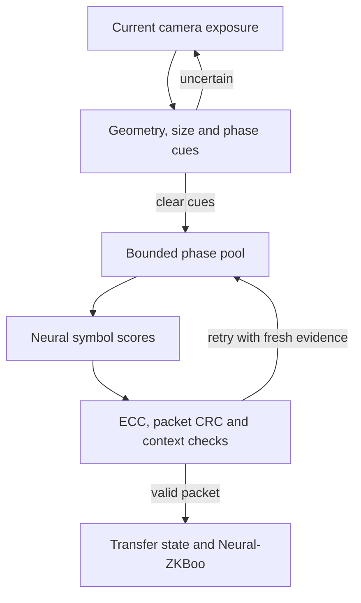

# Neural-QR: optical transport designed for a neural corrector

**Status: version-2 acquisition and collection implemented, 6 November 2026.**
`capture.html` renders and acquires Neural-QR without an OBM5 header. It uses
asymmetric orientation markers, repeated optical size codes and phase cues.
The supported grids are G16/G32/G64/G128, rectified directly from the camera
to four pixels per cell along each axis. Neural-QR is the project's custom optical
format, not a standards-compatible QR code.

This milestone collects training evidence. It does not yet deliver Neural-QR
packets or perform QR-free authentication. The working
[Neural-ZKBoo demo](NEURAL_ZKBOO_DEMO.md) still uses its OBM5 color DATA and
standard QR ACKs while W-tube is trained and its browser/packet integration is built.
The collector accepts only the new acquisition layout; it has no OBM5 fallback.

The goal is fast, reliable optical authentication, with Neural-QR carrying both
data and control messages, the **neural-corrector** recovering logical matrix
symbols, and **Neural-ZKBoo** checking the proof. Removing the separate dense
monochrome header should remove an acquisition bottleneck and free layout space.
It does not remove packet framing, error correction, or cryptographic verification.

## Visual layout and implemented acquisition

The figure uses the actual renderer for a **G32, phase-2** training matrix.
Its dashed outlines and letter labels explain the parts; they are not transmitted
marks. Regenerate it after changing the layout with
`node scripts/render-neural-qr-diagram.mjs`.

Read the figure from outside to inside:

- **A–B: geometry and orientation.** Four finder cores locate the plane; the
  bottom-right satellites resolve rotation and reflection.
- **C–D: size and phase.** Two copies of the binary size code select the grid;
  two copies of the color cue pair select the phase in the current exposure.
- **E: color references.** The two fixed palettes measure the camera's observed
  colors without relying on the random payload.
- **F: matrix.** The grid includes fixed reference rows/columns and random data
  cells. Only data cells change according to the phase permutation.

The bottom row shows all four cue pairs. These are four observations of one
logical matrix, not four independent messages. The collector labels their
contents offline from the sender manifest; no labels enter camera acquisition.

The executable version-2 layout is defined in
[`neural-qr/layout.js`](../apps/color-optical-bench/dist/js/neural-qr/layout.js).
The implemented bottom-right fiducial preserves the square localization core and
adds six asymmetric black/white satellite patches. The satellites distinguish
rotation and reflection. Geometry and reference colors stay fixed across phases;
only the phase patches and phase-permuted data colors change.

| Element | Implemented coordinates in the 256-unit square |
| --- | --- |
| Finder centers | (22,22), (234,22), (234,234), (22,234) |
| Payload | x44, y44, side168; G×G cells including grid references |
| Fixed palettes | x22/x234; 16 colors centered at y52+10i |
| Phase pairs | x104/x132 at y20, repeated at y236; 20-unit patches |
| Bottom-right satellites | x214 at y226/234/242 has bits100; y214 at x226/234/242 has bits110 |
| Size-code copy 1 | 8-unit patches; row-major x48/60/72/84 at y16 and y32 |
| Size-code copy 2 | 8-unit patches; row-major x160/172/184/196 at y224 and y240 |

The collector displays uniformly random logical symbols with fixed reference
cells, not an encoded application packet. It is suitable for learning the optical
correction task without requiring a trained model to label recordings.

The model for these inputs is **W-tube**, with shared processing weights and
independent low-frequency anchors for G16/G32/G64/G128. Its Python training and
evaluation are implemented; trained device accuracy and browser integration
remain to be measured. The existing `multires` model and its 2×2-cell
training/export path remain a separate experiment and cannot load version-2
recordings directly. The [roadmap](ROADMAP.md) separates these tasks.

Current rectification uses **4×4 pixels per cell**: G16 → 64×64, G32 → 128×128,
G64 → 256×256 and G128 → 512×512. It samples directly from the camera image,
without creating a smaller intermediate crop. Drawing cell dimensions are
illustrative display units, not camera sampling pixels; the receiver also
reports actual camera pixels per cell.

## Design boundaries

| Layer | Responsibility |
| --- | --- |
| Neural-QR geometry and optical cues | Locate and orient the image; read G and a clear palette phase; measure color references |
| neural-corrector | Convert distinct captured frames into logical symbol scores |
| Error correction and packet parsing | Recover bytes; reject damaged or malformed packets; check session, message and sequence context |
| Neural-ZKBoo | Verify the existing proof against the pinned public identity and fresh challenge |

Neural confidence is evidence for classification, not proof that bytes are exact.
CRC and Reed–Solomon recovery address channel errors, not a malicious sender.
The existing proof and authentication envelope remain the canonical crypto layer.

## Starting profile and shared multi-resolution model

The acquisition profile is **16 colors, four palette phases and grid-8
references**. Repeated binary size codes optically select G16/G32/G64/G128.
The receiver checks that observed size against its public collection assignment;
a different or uncertain size is rejected rather than guessed from the expected
profile. Error correction belongs to the future packet profile.

Preserve palette masks `(0, 15, 7, 8)`, logical-label output and phase pairing:
four to eight distinct exposures, at most two per phase. W-tube
accepts `4G×4G` RGB crops. Training/evaluation is implemented; export and live
packet integration are next steps; no existing checkpoint is declared compatible with the new design.

Preserve the reference-grid convention and measured color normalization. Retain
the G64/RS32 data profile as a comparison while adding smaller controls and larger
payloads; overhead and error-correction settings must fit each profile.
Reclaiming header space may enlarge displayed cells, but a fixed G64 symbol grid
does not automatically carry more bytes. The final renderer determines the gain.

## Capacity: symbols, camera pixels and bytes

**G16 has 128 gross bytes, not 512, with a 16-color palette.** Each cell holds
one of 16 symbols, so it represents `log2(16) = 4` bits. Therefore:

`16 × 16 cells × 4 bits ÷ 8 = 128 bytes`.

G32 has the 512-byte gross capacity. The grid size includes reference cells, so
actual space available for encoded data is smaller:

| Grid | Rectified RGB crop | Gross bytes without references | Grid-8 data cells | Whole data bytes before packet/ECC overhead |
| --- | --- | ---: | ---: | ---: |
| G16 | 64×64 | 128 | 169 | 84, plus 4 bits |
| G32 | 128×128 | 512 | 729 | 364, plus 4 bits |
| G64 | 256×256 | 2,048 | 3,136 | 1,568 |
| G128 | 512×512 | 8,192 | 12,544 | 6,272 |

These counts come from the implemented `gridLayout(G, 16, 8)`. Framing, error
correction and integrity fields must fit inside the remaining data capacity;
the application-payload capacity is not defined until that packet profile is
implemented. The collection matrices contain random symbols, not packets.

**Four palette phases repeat the same logical information.** Their different
colors help recover the original symbols; they do not multiply payload bytes
by four. Likewise, **4×4 camera pixels per cell** means sixteen RGB measurements
of one color symbol, not sixteen independent symbols. Stored training labels
use one byte per symbol for convenience, but that is a file representation,
not the optical bit capacity.

## Geometry and orientation

The detector keeps **four anchor locations**, using three ordinary high-contrast
finders and one **oriented asymmetric bottom-right fiducial**. Its six satellite
patches distinguish handedness as well as rotation while retaining the same
accurately localized square core. Acquisition tries all rotations and reflected
orders, then validates the asymmetric pattern.

Four point correspondences determine the planar perspective transform. Removing
a corner would require recovering additional constraints from marker edges or
the frame; three point correspondences alone determine an affine transform.
See the primary [OpenCV transform reference](https://docs.opencv.org/4.x/da/d54/group__imgproc__transform.html).

Keep finder contours black/white and unchanged through the phase cycle. The
colored phase cues sit in separate patches with clear spacing. This keeps
geometry detection independent of phase color, exposure shifts and palette noise.
Known ordered border references also provide an orientation consistency check.
The acquisition implementation tries recent geometry first, then reacquires when
current cues disagree or the 400 ms geometry-age bound expires. Finder cores,
rings, asymmetric patches, repeated size codes and phase cues are checked again
against the current exposure.
Reusing coordinates never supplies old phase data or extends the original
geometry acquisition time.

## Optical size code

The two eight-patch codewords are read in row-major order, with black=1 and
white=0. Their pairwise Hamming distance is four:

| Grid | Codeword |
| --- | --- |
| G16 | `11110000` |
| G32 | `11001100` |
| G64 | `10101010` |
| G128 | `10011001` |

The patches are separate from the fixed orientation satellites, so grid choice
does not change handedness or corner localization. Both copies remain unchanged
through every phase of a matrix.

After orientation, acquisition estimates a black/white midpoint from the finder
measurements. Each patch must be at least 0.18 times finder contrast away from
that midpoint; uncertain patches are rejected before codeword classification.
Each copy must match an exact valid word and both copies must agree. The code's
separation provides error detection; this implementation does not repair a
nearby word or use the expected profile to fill missing bits.

Only after reading G does the detector read phase cues and sample the `4G×4G`
crop. A supplied expected profile is a cross-check, never the source of G.
Cached geometry is subject to the same current-exposure code checks. The code
routes acquisition/model geometry; it does not identify or authenticate the
logical matrix and cannot replace packet integrity checks.

## Phase cues without the dense header

Acquisition measures large, repeated color patches against fixed palette
references in the **same exposure**. Each pair for phase `p` uses palette entries `(p, (p + 1) mod 4)`, using the four well-separated
entries at the start of the existing palette. Repeat that pair on the opposite
side of the frame. These cue colors are specified independently of the payload's
XOR phase permutation; the reference palette itself stays fixed.

The detector compares cues with the observed reference colors in RGB space,
requires separation between references and a margin between candidate phases,
and requires the top and bottom copies to agree. An uncertain
or inconsistent exposure is skipped. Top/bottom disagreement is useful evidence
of a display transition or rolling-shutter mixture. These are robust optical cues,
not a second byte-oriented header or an authentication mechanism.

The collector no longer requires the 512-bit header or its CRC to acquire a crop.
It does **not** imply that every frame is usable, or that one patch's
nearest color is sufficient evidence of its phase. Test cue colors and thresholds
under blur, clipping, glare and camera color processing before freezing the layout.

## Collection identity and sample admission

Without an optically decoded packet identifier, a phase number alone cannot
identify which random matrix is on screen. The collector therefore uses an
explicit **public collection code**, shown by the sender and assigned to the
receiver together with the expected grid size. The eight hexadecimal characters are the
CRC32 of the logical training matrix. The sender manifest retains its full
SHA-256 and labels for offline validation; the receiver receives neither labels
nor clean pixels. The join checks code, profile, phase and manifest consistency
and rejects conflicting sender assignments.

The code is an out-of-band association, **not a value recovered from the camera**.
On the demo server, sender creation stages its manifest and publishes a public
collection-session descriptor. The receiver automatically reads the code, profile
and split; completed receiver upload finalizes the sender and clears the descriptor.
Manual code entry remains available on static hosts. No sender labels enter
acquisition. See [the collection workflow](MULTIRES_COLLECTION.md).
Typing a valid code while photographing another matrix can mislabel a recording;
phase agreement and image similarity cannot prove otherwise. Keep one static
logical matrix assigned for all four phases, save the batch before changing it,
and review suspect recordings offline. Full packet identity will move in-band
when the trained receiver and codec are integrated.

Admission requires clear geometric orientation, agreeing size and phase cues,
and agreement with the assigned collection profile. The
collector then waits at least 500 ms and two observations of the same assigned
phase before retaining evidence. A corner displacement exceeding 4% of the
current diagonal restarts this settling guard. Payload CRC success is not an
admission gate:
these training matrices are random symbols, without an application packet or
packet CRC. Similarity selection uses only captured pixels and does not consult
sender truth. See [collection and retention](MULTIRES_COLLECTION.md) for the
centered sample distribution and exact workflow.

## Packet boundaries and metadata — next integration

Place packet type, full session/message identifiers, sequence, length and packet
integrity checks **inside the ECC-protected color payload**. Fixed profile
geometry defines symbol packing and the ECC block layout before those fields are
read. Decode the complete fixed-size body, then validate its encoded length and
packet schema. Pad unused cells as in the current dense training distribution.
Keep full-message digest checks and current transfer matching above this layer.

The collection code solves offline labeling for a manually held training matrix.
It is not the live protocol's packet-membership mechanism. Phase labels alone do
not identify a logical packet, so the live receiver still needs the following
in-band checks and bounded transition behavior.

For the first implementation, retain **strict stop-and-wait** and a bounded pool
of the latest one or two distinct captures per phase. Reset after an accepted
packet and on run/geometry discontinuities; reject stale observations by age.
Old/new packet mixtures can occur during a transition, so failed recovery must
allow fresh observations to replace them. A repeated accepted packet can reproduce
its ACK but must not be delivered to the application twice. Only an ECC/CRC-valid
packet with matching full identifiers and sequence may advance the transfer.

Evaluate this transition behavior before adding simultaneous packet windows. A
small, coarse generation cue is an optional grouping aid if recovery stalls; it
must not replace the full in-band identifiers or become another dense header.
This is a design decision to test, not an already implemented grouping guarantee.

## ACKs and control messages — next integration

The shared multi-resolution corrector makes a **smaller Neural-QR control profile**
the preferred path. Select the smallest grid that fits the complete ACK plus
reference cells, framing, ECC and integrity checks. G16 is the smallest current
profile; its nominal 128 bytes before reference/framing overhead do not guarantee
that it can hold every control message.
Keep ACK binding to transfer, message, acknowledged sequence and digest.

Use the same four-phase, four-to-eight-capture contract initially; smaller grids
reduce neural computation without claiming that a single exposure is sufficient.
One shared model can serve small controls and large data after mixed-size training
and export. Until that integration is available, the G64 envelope can exercise the
same codec on both paths. Measure control acquisition, processing and physical-turn
latency directly rather than assuming that removing standard QR makes it faster.

After grouping is reliable, cumulative acknowledgments and selective retransmission
can reduce physical turns. Do not advance through unrelated packets on a timer
without retaining the receiver's missing-packet state.

## Acceptance tests and measurement

- Geometry: perspective, all rotations, reflection, partial occlusion and confusing
  background shapes. A tentative location is distinct from an accepted packet.
- Size codes: all four grids, uncertain patches, corrupted words, conflicting
  copies and a valid optical G that disagrees with the expected assignment. No
  rejected exposure may enter a retained training pool.
- Phase cues: same-exposure color correction, clipped colors, motion blur, glare,
  rolling shutter and frames spanning a phase transition. Uncertainty causes retry.
- Burst membership: skipped phases, repeated exposures, old/new packet mixtures,
  duplicate packets, camera motion, restart and expired samples. Buffers stay bounded.
- Bytes and authentication: exact delivered bytes, no damaged packet acceptance in
  the test set, mandatory packet/message checks, lost ACK recovery, stale challenge
  rejection, altered proof rejection, and the final result acknowledgment.
- Devices: repeat phone→PC and PC→phone, record unique acknowledged bytes per second,
  acquisition/inference/ACK timings and complete authentication time. Keep image size,
  devices, repetitions and physical placement comparable when testing standard QR.

On **4 November 2026**, the existing hybrid demo completed a 32-repetition exchange
in about **6 min 17 s**. Its 17,474-byte proof took about 160 seconds to send and
acknowledge, approximately **109 B/s** including turns. Earlier favorable QR-only
transfers reportedly reached roughly 1 kB/s under different conditions. These
observations establish useful neural-assisted reception and end-to-end function;
they do not establish a controlled throughput advantage over standard QR or an
audited cryptographic security result.

## Implementation sequence

1. **Implemented:** version-2 header-free renderer, asymmetric orientation,
   repeated size/phase cues, direct 4×4-pixel crops for G16/G32/G64/G128, public
   collection assignment, bounded recording pools, uploads and offline joining.
   Validate this layout on both devices before a large recording session.
2. **Implemented:** [offline dataset preparation](W_TUBE_DATA.md) imports eligible
   original G64 crops and bicubic-upsampled recordings with explicit origin tags,
   preserves their splits, and generates harder paired synthetics at a 4:1
   capture ratio. New native recordings remain the primary validation source.
3. **Implemented:** W-tube training/evaluation and strict checkpoint loading.
   Train from scratch against the prepared four-pixel corpus; native validation
   is primary and auxiliary origins are reported separately. A real-origin
   sampling quota, further history slimming and ONNX/browser parity remain next.
4. Add the in-band ECC/CRC packet codec and full identifier checks, bounded
   packet/phase association and small Neural-QR controls to authentication. This
   replaces the working OBM5/QR-ACK path when both endpoints are ready.
5. Complete QR-free authentication in both role arrangements and improve
   capture/inference scheduling and acknowledgment windows from measured costs.

The standalone standard-QR experiment remains a comparison tool. The runnable
Neural-ZKBoo baseline and header-free data collector are explicitly separate
entry points, not a receiver that guesses between formats. See the
[roadmap](ROADMAP.md) for end-to-end completion criteria.

## License and attribution

The project's original Neural-QR implementation and design documentation are
covered by [Apache-2.0](../LICENSE), with project/author attribution in
[NOTICE](../NOTICE): **Alejandro Hernandez Ruiz (magnux), Neural Cryptography**.
See [licensing scope](LICENSING.md) and [CITATION.cff](../CITATION.cff).
Third-party components retain their own terms and credit. Licensing these materials
does not claim ownership of standard QR, neural networks or earlier cryptographic methods.
