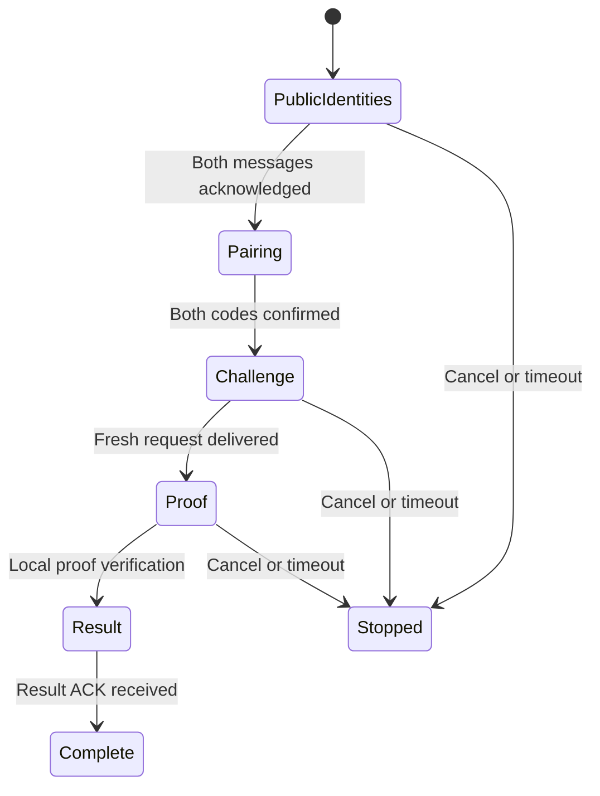

# Neural-ZKBoo color authentication demo

`apps/color-optical-bench/dist/neural-zkboo.html` is the separate, turn-based
authentication interface. It carries the existing neural-key ZKBoo-style proof
over color matrices, using the trained **U-tube-2x-attn** corrector for incoming
data and the classical receiver for small ACKs. The QR interface remains a
separate experiment. **Neural-ZKBoo** is the protocol's project name; this naming
change does not alter its existing proof bytes or circuit.

The implementation is ready for a first physical-device test. Automated checks
exercise the real 32-repetition proof and clean rendered matrices; they do not
establish live-camera reliability or speed with the trained checkpoint. The
model's recorded validation success motivates this test, rather than replacing it.

## Prepare the trained model and app

Both devices need the prepared, trained G64 phase-grouped model. Directory
renaming alone does not update an older checkpoint's descriptive profile: follow
the [one-time checkpoint metadata instruction](CORRECTOR_LAB.md#rename-the-descriptive-profile-in-an-existing-checkpoint)
first. No retraining is needed. From the repository root:

```sh
python experiments/neural-corrector/export.py \
  --checkpoint checkpoints/neural-corrector/U-tube-2x-attn/best.pt \
  --out experiments/neural-corrector/artifacts/selected
npm ci --prefix experiments/neural-corrector/browser-runtime
npm run prepare:apps
npm run prepare:corrector -- --artifacts experiments/neural-corrector/artifacts/selected
npm run test:corrector:wasm -- --artifacts experiments/neural-corrector/artifacts/selected
python apps/color-optical-bench/serve.py \
  --host 0.0.0.0 --port 8000 --https \
  --cert certs/dev.pem --key certs/dev-key.pem
```

Use a certificate trusted by the phone and matching the server hostname. Open
`https://YOUR-COMPUTER-HOST:8000/neural-zkboo.html` on both devices. For a local
webcam-only check, the server can instead use ordinary localhost HTTP. The
[serving guide](CORRECTOR_LAB.md) explains the ONNX bundle and runtime assets.
The demo rejects untrained bundles and incompatible model input contracts.

The server serves static code and model files. It does not generate keys,
receive camera frames, create proofs, or verify them. Initialization caches the
model in each device's worker. To test offline operation, first **start both
devices and wait until both show the trained model and camera ready**, then
disconnect the server/network while leaving both pages open. Do not disconnect
before initialization or reload afterward: the first load still needs assets.

## Default configuration

| Setting | Initial value | Purpose |
| --- | --- | --- |
| Cryptographic circuit | Side 8, 16 circuit rounds | Same reduced-proof test circuit as QR authentication |
| Proof repetitions | 32 | Quick development test; 17,474 raw proof bytes |
| Other repetition choices | 64, 110, 160, 219 | Increase proof work and size; not certified security levels |
| DATA and START matrices | 64×64, 16 colors, grid-8 references, RS32 | Trained corrector's supported geometry |
| Palette phases | Four permuted phases | Exactly the model's phase-grouped input |
| Phase display interval | 95 ms | Sender target; approximately 380 ms per four-phase cycle |
| Camera sampling interval | 100 ms | Receiver target between distinct camera exposures |
| Model input | K=4…8 captures | At least one capture of every phase, up to two per phase |
| ACK matrices | 32×32, four colors, no local grid, RS16 | Small single-phase classical decode; no neural inference |
| Multipart payload | Up to 1,200 bytes per DATA packet | One packet outstanding; wait for its matching ACK |
| Camera / backend | 720p / Auto | WebGPU when available, with initialization fallback to WASM |

Choose matching proof repetitions for the first test. The verifier's requested
count must satisfy the key holder's minimum; the application checks this policy.
Changing repetitions leaves the optical geometry and corrector unchanged.

The 95/100 ms offset helps sample different points in the display cycle. It does
not synchronize camera exposures or guarantee four valid phases in 400 ms.
Display refresh, rolling shutter, exposure, detection and inference all add
latency; processing can reduce the actual sampling rate. Capture and inference
run without an accumulating job queue. If phases are consistently missed, try
**190 ms display / 100 ms capture**, and report both settings and results.

## Device sequence and physical turns

1. Choose **Verifier** on the PC and **Key holder** on the phone. Start with 32
   repetitions on both, select cameras, and press **Start authentication** on
   each device. The verifier sends first; the key holder initially receives.
2. Aim the receiver at the sender's complete matrix. A filled alignment overlay
   and per-phase counts show acquisition. The sender keeps cycling the same
   logical matrix until it receives the matching ACK.
3. When the receiver displays **ACK**, turn the phone so the sender's camera can
   read that ACK. Keep it visible until the sender advances. Aim back at the
   sender's next matrix. Repeat this for the message START packet and every data
   chunk; simultaneous bidirectional alignment is unnecessary.
4. At the end of a message, its final ACK remains visible. Wait for the sending
   device to confirm that the outgoing message was fully acknowledged. If the
   receiver has a reply ready, press **Send next turn** there. This explicitly
   replaces the final ACK with the next outgoing message.
5. After both public identities arrive, compare the pairing code on the two
   screens and press **Codes match · confirm** on both. Stop and restart if they
   differ. Confirmation may queue the next outgoing turn; use the same final-ACK
   handoff before sending it.
6. Transfer the fresh challenge, then the generated proof, using the same turns.
   The verifier checks the proof locally and sends its result. **Also deliver
   the final result ACK** so the verifier knows that result delivery finished.
7. Download a report from each device, including any failed attempt. Repeat with
   roles reversed after the first successful exchange.

The **Verified locally** result on the verifier differs from the key holder's
**Peer reports accepted** result. This iteration proves the key holder's secret
to the verifier; the result message does not prove the verifier's identity.
Keys are ephemeral and stay in the browser workers. There is no persistent
enrollment or mutual authentication in a single attempt.



Each message in this sequence uses a START/ACK exchange, followed by sequential
DATA/ACK exchanges. Phase repetition continues until acknowledgment rather than
sending a new chunk on a timer. The explicit handoff is especially useful when
the phone must be physically turned between receiving and displaying.

## Corrector and transport behavior

The worker detects and validates the monochrome header, rectifies each camera
frame, and applies the same measured color normalization/input contract as the
trained model. It collects distinct exposures into the four phase pairs, first
tries K=4, and incorporates additional observations through K=8 after recovery
fails. At capacity it replaces older evidence and tries again; transient missed
headers do not discard all useful observations. Matrix identity changes and
evidence age bounds prevent unrelated frames from mixing.

Logical palette scores pass through the existing Reed–Solomon and CRC recovery
path. **Only CRC-valid bytes reach the multipart receiver.** Known sender data
or expected proof bytes never enter correction. ACK reception uses the small
classical profile so a device does not need another four-phase neural burst
just to acknowledge a packet.

Non-ACK packets are wrapped in the current `NZM1` optical container, which records
the packet length and fills the remainder of the 1,344-byte matrix payload with
secure random bytes. This makes short START/identity messages visually dense,
closer to the random data used during training. Padding is not an authentication
mechanism. The OLM1 packet identities, sequencing and whole-message digest remain
responsible for transport consistency, while Neural-ZKBoo verifies the proof.

Buffers and reports are bounded. A message has a ten-minute deadline and an
authentication attempt a thirty-minute deadline. Cancel/reset stops workers and
camera tracks. Hiding the page also stops the attempt; reopen and start fresh on
both devices. Stay on the page while waiting for an ACK or generating a proof.

## What to report from the first device test

Save both JSON reports and note the phone/PC models, browser versions, selected
cameras, display brightness/size and physical arrangement. Reports exclude
camera images and private keys; they include settings, model/backend identity,
recent inference timings, received/accepted matrix counts, transport progress,
authentication state and bounded event history. Add a short note naming the
step that stalled, if any.

Start with the default 95/100 ms settings and 720p. Check these outcomes in order:

1. Both trained models initialize and cameras detect the complete markers.
2. START and DATA ACKs advance the sender, including the final message ACK.
3. Public identities arrive and pairing codes match.
4. The 32-repetition proof arrives, verifies, and the result is acknowledged.
5. The same exchange succeeds with roles reversed and after server disconnection.

If a run stalls, distinguish missing phases, repeated CRC failure, slow neural
inference, and unreadable ACKs. Try the longer phase interval before changing
resolution. Do not change matrices to 128×128 or add palette phases for this
model: its trained contract is specifically G64/16 colors/four phases.

The first goal is a completed, measurable exchange. Live recovery rate,
throughput and practical reliability still need these physical tests; recorded
validation and clean-render tests cannot determine them.

## Source boundaries

| Component | Canonical source |
| --- | --- |
| Turn-oriented UI, capture loop and local report | `apps/color-optical-bench/dist/js/neural-auth/app.js` |
| Message turns and sticky ACK handoff | `neural-auth/channel.js` |
| Stop-and-wait multipart state | `neural-auth/transport.js` |
| DATA/ACK matrix profiles and optical container | `neural-auth/optical.js` |
| Learned crop collection, ONNX inference and CRC recovery | `js/corrector-lab/worker.js` and `js/learned-input.js` |
| Public-key pairing/challenge/proof/result session | `shared/browser-crypto/auth/`, prepared into `js/auth-core/` |
| Neural proof engine and crypto worker | `shared/browser-crypto/` |

The neural proof engine and authentication session have one canonical source;
the QR and color interfaces provide separate transport adapters. Prepared assets
under each app are generated copies. No hosted site is activated by this work.

Run `npm run test:neural-zkboo` from the repository root for the focused demo checks.
