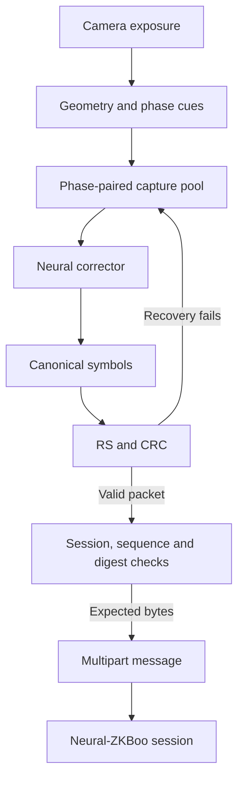

# Neural-ZKBoo over Neural-QR

`apps/color-optical-bench/dist/neural-zkboo.html` runs the turn-based authentication
POC using **header-free Neural-QR for both data and acknowledgments**, corrected
by the trained **VW** or **W-tube** model. The physical directions have independent
limits: G128 from computer to phone, G64 from phone to computer. Authentication
roles can be reversed without reversing these limits.

This iteration integrates the existing trained model and Neural-ZKBoo proof;
it does not require another training run. It replaces the earlier G64 transport
and standard QR ACKs. The separate QR experiment remains available for reference.
Neural-ZKBoo is the project's ZKBoo-style neural-key protocol name, not a change
to the proof circuit or a claim of independently established cryptographic security.

The original implementation and documentation use [Apache-2.0](../LICENSE), with
author/project attribution in [NOTICE](../NOTICE). See [licensing scope](LICENSING.md).

## Prepare and serve

Export the trained checkpoint with all receiving geometries. Use your actual
checkpoint path if its directory has a different name:

```sh
python experiments/neural-corrector/export.py \
  --checkpoint checkpoints/neural-corrector/vw-distill/best.pt \
  --sizes 32 64 128 \
  --out experiments/neural-corrector/artifacts/selected
npm ci --prefix experiments/neural-corrector/browser-runtime
npm run prepare:apps
npm run prepare:corrector -- --artifacts experiments/neural-corrector/artifacts/selected
npm run test:corrector:wasm -- --artifacts experiments/neural-corrector/artifacts/selected
python apps/color-optical-bench/serve.py \
  --host 0.0.0.0 --port 8000 --https \
  --cert certs/dev.pem --key certs/dev-key.pem
```

The export produces one static ONNX graph per size, numerical fixtures and a
manifest. PyTorch-to-ONNX Runtime parity is checked during export; the WASM test
checks the browser runtime implementation. Export the student inference model:
the training-only EMA teacher and projection block are not needed in the app.
The demo accepts trained, four-phase, eight-slot, four-pixels-per-cell W-tube/VW
bundles. G16 is optional for other experiments, but **cannot carry this demo's
complete control packets**; G32 must be present.

Use a certificate trusted by the phone and matching the server hostname. Open
`https://YOUR-COMPUTER-HOST:8000/neural-zkboo.html` on both devices, with the same
prepared app and artifact bundle. Localhost HTTP is enough for a computer-only
webcam check. See [the serving and corrector guide](CORRECTOR_LAB.md) for runtime
assets and certificate setup. After updating, prepare the app and reload both
devices. No hosted site is automatically activated.

The server supplies static app code and models. Keys, camera frames, proof
creation and verification stay on the devices. The browser loads ONNX files,
not the `.pt` checkpoint. Static attention masks can make those files substantially
larger than the checkpoint; allow initialization to finish before timing a transfer.

## Settings and direction

| Setting | Computer | Phone |
| --- | --- | --- |
| **This screen** | Computer | Phone |
| Default outgoing data | G128 | G64 |
| Other outgoing choices | G64, G32 | G32 |
| Incoming maximum | G64 | G128 |
| ACK in either direction | G32, four phases | G32, four phases |
| First authentication role | Verifier | Key holder |

The screen preset describes the physical direction, independently of the
**Authentication role**. A phone acting as verifier still sends at most G64;
a computer acting as key holder can still send G128.

| Shared setting | Default / contract |
| --- | --- |
| Circuit | Side 8, 16 circuit rounds |
| Proof repetitions | 32; 17,474 raw proof bytes |
| Other repetition choices | 64, 110, 160, 219 |
| Neural-QR | 16 colors, grid-8 references, four palette phases, RS32 and CRC32 |
| Phase display interval | 150 ms |
| Camera sampling interval | 100 ms |
| Capture resolution | Requested 1440p; actual camera settings are reported |
| Backend | Auto: WebGPU, with initialization/parity fallback to WASM |
| Model input | K=4…8 distinct captures, one or two per phase |
| Multipart DATA payload | G32: 244 B; G64: 1,288 B; G128: 5,416 B per packet |

Choose 32 repetitions on both devices for the first exchange. A verifier's
challenge must satisfy the key holder's minimum; increasing repetitions changes
proof work and bytes, not the optical format. These are research settings, not
certified security levels.

The four phases repeat the same packet using different palette permutations;
they do not multiply its payload capacity. The payload sizes above exclude the
optical and multipart overhead. G16's remaining protected packet space is too
small for an 84-byte ACK or an 88-byte START, so controls use G32.

Four 150 ms phases take 600 ms to display. This is a display cycle, not a promised
packet latency: exposure, dropped phases, preprocessing, inference and the ACK
turn add time. A 100 ms sampling setting is a target interval between distinct
camera exposures. Processing can make it slower. There is one capture/inference
job at a time and no growing frame queue.

Use **Next outgoing message** to lower the geometry between messages. An active
message keeps its original chunking and geometry. If that message cannot be
read, stop both devices and start a fresh attempt at the smaller size; the app
does not silently rechunk a partly acknowledged message.

## Run the exchange

1. Select the screen presets above and one verifier and one key holder. Select
   cameras and press **Start authentication** on both. Each device first loads
   and checks all its incoming model sizes, then starts the camera and local keys.
2. Aim the receiving camera at the whole Neural-QR, including its corners and
   reference frame. **Orange** indicates detected candidates with uncertain
   orientation, size or phase. **Green** means acquisition cues passed, not that
   the packet or proof has been accepted. The display keeps cycling one packet
   until its matching ACK arrives.
3. When **G32 ACK** appears, turn the phone so the sender's camera can read its
   four phases. Keep it visible until the sender advances. Aim back at the next
   packet. Repeat for START and each DATA packet; simultaneous alignment is not
   required.
4. The final ACK of a message stays visible. Wait until the sender confirms full
   delivery. If the other device has a reply queued, press **Send next turn**
   there. This manual handoff replaces the ACK with the next message.
5. Compare the pairing codes on both screens and press **Codes match · confirm**
   on both only if they match. Stop and restart if they differ. Continue the
   same handoff for challenge, proof and result.
6. Deliver the result's final ACK too. The verifier should show **Verified
   locally** with result delivery complete, and the key holder **Peer reports
   accepted**. Download a report from both devices.

The five application messages are HELLO, IDENTITY, CHALLENGE, PROOF and RESULT.
Each message has its own START/ACK and sequential DATA/ACK exchanges. Duplicated
packets and repeated final ACKs do not create duplicate application deliveries.

This is one-way proof of the key holder's secret, using fresh ephemeral keys and
a fresh, pairing-bound challenge. Both public identities are exchanged and
compared, but the result message is not a second proof of the verifier's secret.
Swapping roles in a new attempt tests the other direction; it does not turn one
attempt into mutual authentication or persistent enrollment.

## Correction, packet acceptance and resource bounds

The receiver first tries recent geometry on the current exposure. Its maximum
age is **twice the configured camera reading interval**: 100 ms sampling gives
200 ms hints; 500 ms sampling gives 1,000 ms hints. Age is measured from the last
full geometric detection, and successful reuse does not extend it. The setting
uses the requested interval, not time spent waiting for slow inference. Current
finder positions, orientation, size, phase and color references must still pass
measurement; a cached transform is never permission to reuse an old phase.

Marker acquisition uses a fast global search first, followed by bounded local
threshold and higher-resolution searches when needed. Each finder has local
black/white references, so a reflective corner is not judged against a shaded
corner's brightness. Orientation is scored against alternative corner orders,
with confidence required before sampling the payload. Size codes still have to
agree, and phase cues are read from the current exposure. Verified geometry can
survive an unreadable phase while its age permits; that exposure contributes no
neural input. Detector normalization operates on grayscale working buffers;
color calibration and the corrector continue sampling the original RGB frame.
There is no monochrome payload header or settling delay in this path.

Acquisition feedback distinguishes missing markers, rejected quadrilaterals,
insufficient finder contrast, ambiguous orientation, size codes and phase cues.
Orange is placement feedback; green indicates current acquisition cues passed.
Neither substitutes for packet RS/CRC and transfer checks.

Rectified inputs use 4×4 pixels per cell: 128×128 at G32, 256×256 at G64, and
512×512 at G128. The model input has eight RGB slots and eight presence planes
(32 channels). One exposure from each phase permits the first K4 attempt. After
failed recovery, the next inference waits for two captures per phase (K8).
Further K8 retries wait for four new valid captures in total, which need not be
one from each phase. The pool replaces the oldest sample of the newly observed
phase. Missed detections and duplicate exposure callbacks do not count toward
those four captures. The model emits canonical logical-color logits; phase inversion
must not be applied again to its output.

Geometry and phase cues are not a packet identity. A transition between packets
can temporarily mix observations and fail recovery; fresh exposures replace
those observations until a protected packet can be recovered. The receiver
resets its pool on geometry, run or DATA/ACK mode changes and expires old
observations within 60 seconds. It never uses expected sender bytes to guide
correction or acceptance.



The current `NQP1` in-band container carries protected geometry, packet kind and
length, followed by the OLM packet and random padding. Reed–Solomon protection
and CRC32 cover the container. Grid references stay in their physical colors;
only payload cells follow the four phase permutations. Random padding keeps
short control packets visually dense; it is not authentication.

A corrected matrix advances transport only after RS/CRC recovery, container
validation and matching multipart identifiers/state. The full message digest is
checked before application delivery. Proof verification, challenge binding and
replay rejection remain separate cryptographic checks. ACKs use this same
Neural-QR/corrector path, not a QR decoder or an old optical-header fallback.

The live capture pool holds at most eight crops: 24 MiB at G128, before the packed
input, camera image and runtime working memory. Initialization fetches and
verifies all allowed incoming artifacts: G32/G64 on the computer and G32/G64/G128
on the phone. It checks browser numerical parity for each, keeps at most two
compiled sessions, and retains the verified model/fixture bytes for all allowed
sizes. Returning to an evicted size recompiles it from those bytes. Actual peak
memory includes runtime/GPU allocations and is not inferred from the buffer bound.

After **both devices show the model and camera ready**, all allowed incoming
sizes are available in the workers for the current attempt, including a smaller
fallback size. You can disconnect the server/network and leave both pages open
to test offline operation. Reloading, cancelling/restarting the workers, closing
or hiding the page requires a new attempt and may need the server again; this is
not an installed offline app. No CDN is required during the exchange.

A message has a ten-minute deadline and an authentication attempt thirty minutes.
Cancel/reset stops workers and camera tracks. Hiding the page stops the attempt;
keep both pages in the foreground while turning the devices or waiting for proof
creation.

## Webcam exposure and focus

After the camera starts, expand **Camera exposure & focus** to see the controls exposed
by that particular camera/browser. Unsupported controls are unavailable. No
exposure or focus setting changes automatically at startup. Try a small negative
exposure compensation, or manual exposure if available, when the phone's bright
patches are clipped in the webcam feed. Focus controls are useful only when the
camera actually has adjustable focus. The panel and report distinguish requested
values from the camera's reported settings; rejected changes are shown without
stopping authentication.

These are camera settings, not a brightness filter over the neural input. Global
post-capture darkening cannot restore clipped details. Reduce reflections and
adjust exposure while keeping all four markers visible. Leave the phone phase
interval slow initially if useful, but the camera reading interval can remain
100–200 ms. A 500 ms interval is also supported, with a 1,000 ms geometry hint.

For the first retest, keep the trained model and grid unchanged. Compare the
same position and lighting with automatic camera settings, then one exposure
change. Save both device reports, including failed attempts. The report records
acquisition stages, bounded recent diagnostics, geometry reuse and camera
control settings, without uploading frames or private keys.

## First device tests and reports

Run these short checks before increasing proof repetitions:

1. **Model and camera readiness.** Confirm parity passes for G32/G64 on the PC
   and G32/G64/G128 on the phone. Use Auto first; record the effective backend,
   initialization time, inference time and actual capture resolution. If the
   browser reports a memory/runtime error, save that report before restarting.
2. **Conservative full exchange.** Choose G64 outgoing on both devices, keeping
   150 ms phases, 100 ms sampling and 32 repetitions. Verify packet ACKs, matching
   pairing codes, completed proof verification and final result acknowledgment.
3. **Asymmetric exchange.** Use computer G128 and phone G64. Compare inference
   latency and sent-message goodput with the G64 baseline. A larger packet helps
   only if acquisition, inference and ACK timing make the whole exchange faster.
4. **Recovery and role swap.** Briefly cover the camera while an ACK is displayed,
   then restore alignment. Confirm the same packet retries without duplicate
   delivery. Test smaller geometry between messages, then a fresh attempt with
   roles reversed while keeping the physical screen presets unchanged.
5. **Offline exchange.** Start both devices online, wait for model/camera readiness,
   disconnect the server/network and finish a 32-repetition exchange. Keep the
   pages open. Check a permitted smaller outgoing geometry at a message boundary
   as well if the exchange needs fallback.

Download both **version 2** JSON reports, including failures. Add the device and
camera models, brightness, approximate distance/angle, lighting, and what stalled.
Useful comparisons are:

- Effective backend and per-size startup parity/inference timings.
- Actual and processed camera resolution, observed pixels per cell, missing phases
  or orange acquisition feedback.
- Per-grid capture attempts, inference count/time, CRC-accepted matrices and
  transport-accepted matrices, with separate DATA/ACK failure stages.
- Per-message bytes, elapsed time and goodput in **bytes/second**, proof creation
  and verification times, and final outcome on each device.

Sent-message goodput includes the final ACK; received-message timing starts at
the first valid START and ends at message assembly. Compare sent-message metrics
when assessing throughput. Reports are bounded and contain no camera images or
private keys.

Automated tests run actual 32-repetition cryptography through clean rendered
Neural-QR acquisition, phase packing, a deterministic test-only classifier, and
RS/CRC recovery in both directions. They check G32 ACKs, G128/G64 chunks, lost
final ACKs, duplicates, tampered proofs and challenge/session binding. They do
not substitute for the trained checkpoint's browser parity or live-camera tests.
Run `npm run test:neural-zkboo` for the focused suite.

## Source boundaries

| Component | Canonical source |
| --- | --- |
| UI, camera loop and reports | `apps/color-optical-bench/dist/js/neural-auth/app.js` |
| Physical device direction limits | `neural-auth/profiles.js` |
| Turns and sticky final ACK | `neural-auth/channel.js` |
| Stop-and-wait multipart messages | `neural-auth/transport.js` |
| DATA/ACK optical adapter | `neural-auth/optical.js` |
| Header-free drawing and acquisition | `neural-qr/layout.js`, `neural-qr/vision.js` |
| Protected optical packet and shared RS framing | `neural-qr/packet.js`, `neural-qr/fec-packet.js` |
| Geometry reuse and acquisition feedback | `neural-auth/capture.js`, `neural-auth/feedback.js` |
| Burst packing, ONNX execution and artifact cache | `corrector-lab/live-burst.js`, `runtime.js`, `worker.js` |
| Pairing, challenge, proof and result | `shared/browser-crypto/auth/` |
| Neural proof engine and crypto worker | `shared/browser-crypto/` |

The JS paths after the first row are relative to the app's `dist/js/` directory,
except the explicitly named shared sources. `prepare:apps` copies the canonical
crypto sources into each app. See [Neural-QR](NEURAL_QR.md) for the visual format
and [the corrector design](NEURAL_CORRECTOR.md) for the models.
