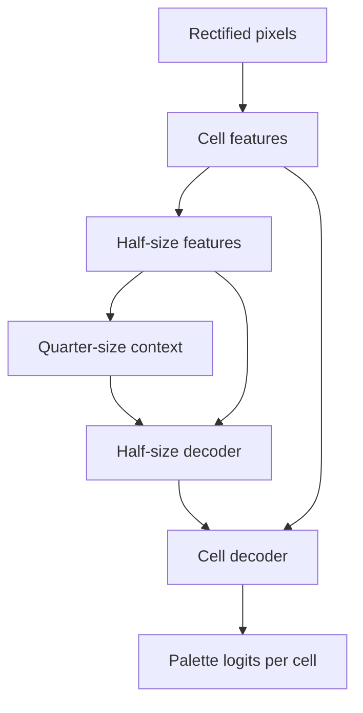

# Learned color-matrix decoder: design and training plan

Status: **G64 device feasibility established; M2 capture/training software implemented**, 2026-10-22.
The submitted reports establish phone WebGPU and PC WASM parity and speed at G64. PC crop acquisition and G128 device
measurements remain open. Use [the M2 guide](OPTICAL_DECODER_TRAINING.md) for capture, synthetic generation, training,
and held-out evaluation, and [Decoder Lab](DECODER_LAB.md) for checkpoint parity/device timing. Real-data model
improvement and live learned recovery remain unvalidated. The immediate goal is browser-to-browser authentication
using the existing Neural ZKBoo engine and color optical transport. This receiver improvement belongs to the shortest
path in [ROADMAP.md](ROADMAP.md); cryptanalytic research remains future work in
[RESEARCH_CONNECTIONS.md](RESEARCH_CONNECTIONS.md).

## Scope and first decision

Build a small U-Net-style **denoiser/classifier**: recover the transmitted palette symbol at each cell, rather than
optimize the appearance of a cleaned photograph. Keep finder detection, monochrome header validation, geometry,
Reed–Solomon (RS), CRC checks, and multipart acknowledgments. Neural inference supplies better color evidence to these
existing mechanisms. It never decides whether a proof is valid.

Start with 64×64 and 128×128 physical grids, 16 colors, and a 4-color control. Grid dimensions include reference cells.
Keep grid-8 references and RS32 while reducing phases and capture requirements experimentally. 256/512 grids, learned
geometry, ViTs, Conv3D, and resolution-specific inlet/outlet branches are deferred. Both optical directions matter; the
phone's smaller display may need a different profile. There is no requirement to use identical settings on the two
devices. Keep 32×32/four-color control packets on the current classical decoder
for the first POC; learned control decoding is optional and needs its own G=32 evaluation.

## Input and network

Let G be the physical grid size and C the active palette size. Preserve spatial texture by rectifying the payload region
to **4 pixels per cell**, hence 4G×4G RGB: 256×256 for G=64 or 512×512 for G=128. This is a sampling target, not extra
camera information; record observed camera pixels per cell and reject bad crops. The current `extractCapture()` returns
sampled cell RGB plus palette pilots; its 320-pixel whole-marker preview is not this input. Add a dense payload crop
using its validated homography and `FORMAT.payload` coordinates.

Fit the existing affine color correction from the **current exposure's** border palette, apply it to the dense crop,
divide RGB by 127.5 and subtract 1, then clip to [-1.5, 1.5]. Implement identical preprocessing in training and
JavaScript. Retain the reference grid in the crop; its observed colors provide local context. The reference cells retain
their fixed physical palette labels across phases. No uniform pre-calibration sequence or persistent moiré texture map
is required.

Use ordinary biased Conv2D layers with ReLU, 3×3 kernels and padding 1, except the final 1×1 classification head. No
BatchNorm/InstanceNorm in the first model: absolute calibrated color is useful, and inference should not depend on a
batch.

| Stage | Operation | Output, omitting batch dimension |
| --- | --- | --- |
| Input | One calibrated RGB crop | 3 × 4G × 4G |
| Pixel inlet | Conv 3→8, stride 2; Conv 8→16, stride 2 | 16 × G × G |
| Cell features E0 | Two Conv 16→16 | 16 × G × G |
| Encoder E1 | Conv 16→32, stride 2; Conv 32→32 | 32 × G/2 × G/2 |
| Bottleneck | Conv 32→64, stride 2; Conv 64→64 | 64 × G/4 × G/4 |
| Decoder D1 | Nearest ×2, concatenate E1; Conv 96→32; Conv 32→32 | 32 × G/2 × G/2 |
| Decoder D0 | Nearest ×2, concatenate E0; Conv 48→16; Conv 16→16 | 16 × G × G |
| Head | Conv 16→16, 1×1, no activation | 16 × G × G logits |

This specified graph has **121,792 parameters**, about 0.49 MB of float32 weights, and approximately 0.132/0.528 billion
convolution MACs at G=64/128, excluding preprocessing, activation, resize, and runtime overhead. These are calculations,
not measured phone performance. The same weights serve both sizes; begin with fixed-shape exports from one checkpoint to
reduce deployment uncertainty.

Train a single-frame model first. If needed, a second model stacks five registered RGB captures as 15 input channels;
only the first convolution changes (+864 parameters). Use five distinct captures of the **same sequence, logical frame,
phase, and profile**, within a bounded age. Each gets its own current-exposure correction. Reset on transitions or
geometry loss; do not stack different palette phases. Train with measured subcell alignment errors and focus/exposure
changes. Fall back to the single-frame model when five suitable captures are unavailable. Do not count overlapping
five-frame windows as independent evidence; use disjoint bursts initially. Extra capture delay must earn a net goodput
improvement.

## Integrating probabilities with the existing receiver

The model predicts **physical palette IDs**. For C=4, mask logits 4–15 before softmax; C=16 uses all outputs. After
softmax, exclude reference cells using `gridLayout(...).cells`, and convert each data-cell distribution to logical
symbol order with the existing mapping:

`logicalScores[i, k] = physicalProbabilities[cell_i, paletteMap(k, info)]`.

This inversion occurs before temporal fusion. Header fields select the mapping; the model does not learn or guess phase
identity. Scale probabilities to the current 0–255 score convention, retaining float precision until a bounded pool
requires quantization. A validation-only temperature can calibrate confidence.

Add an evidence entry point to `TemporalDecoder` that accepts these logical scores; the present `process()` only accepts
RGB samples. Keep `decodeScores()` as the downstream boundary: it chooses symbols, calculates top-two margins, and calls
`decodeSymbols()`. Existing byte-reliability ranking, bounded RS erasure trials, interleaving, tail checks, and CRC
acceptance remain authoritative. Report learned and classical candidates separately and retain rejection of conflicting
CRC-valid candidates. Never feed known payloads into inference or RS.

Keep monochrome header detection/checksum entirely model-free. Bad headers and mixed display transitions cannot be
repaired by confidence alone. Continue to use complete-message integrity and the exact expected challenge/proof checks
above transport. A classifier confidence score is not authentication.

## Browser feasibility before training

Export an untrained instance and a deterministic numerical fixture before a long training run. Use PyTorch → ONNX → ONNX
Runtime Web inside a dedicated worker; pin the selected runtime/export versions and bundle model, JS, and WASM locally.
No CDN or inference server is needed during authentication. The exporter may need `onnx`/`onnxscript`; inference
validation can use Python `onnxruntime` separately.

The official [WebGPU operator table](https://github.com/microsoft/onnxruntime/blob/main/js/web/docs/webgpu-operators.md)
checked on 2026-10-19 lists Conv2D, ReLU, Concat, Resize, and Softmax support and explicitly excludes Conv3D. This
motivates the graph; it does **not** establish support or speed for our exact export. Inspect every exported
operator/opset and run numerical parity and timing on the actual phone and PC, with camera active. Use a real worker,
not the WASM proxy option for WebGPU. Explicitly test WASM-only fallback, initially single-threaded; multithreaded WASM
requires suitable browser support and cross-origin isolation. Device/backend selection must be measured.

Initial engineering targets: warm p95 inference ≤100 ms at G=64 and ≤200 ms at G=128 on each receiving device, bounded
additional working memory near 128 MiB, one in-flight inference and one replaceable pending capture. These are targets,
not gates that justify indefinite model optimization. If the target phone misses them, halve feature widths or use G=64
before adding temporal complexity. Measure preprocessing, transfers, inference, and RS separately; drop old camera
frames rather than build a queue. Existing 64 MiB evidence limits remain separate from RGB/tensor/runtime memory and
must be included in total memory reports.

## Real-device capture and ground truth

Extend the existing Optical Bench with a small **dataset capture mode**. Transmit fresh random known bytes through the
current renderer/encoder; export a sender manifest with sequence/frame/phase identifiers, profile, payload hash, and
data needed to regenerate exact encoded symbols, including parity and padding. The receiver records timestamped bursts,
homography, header fields, camera settings, pixels/cell, current reference measurements, and decoder diagnostics. Save
dense crops plus a bounded sample of original frames to allow later rectification fixes.

Join labels offline through validated IDs and the manifest. A successful payload decode is **not** required for training
capture; keep difficult failed payloads. Captures with untrusted frame/phase identity remain unlabeled until
independently resolved, rather than inheriting the last label. Exclude transition mixtures. The sender manifest/seed,
expected bytes, and labels never enter the live decoder.

Capture both PC→phone and phone→PC, including slight hand motion, focus changes, auto white balance, varied
distances/angles, display brightness, 720p/1080p, successful and unsuccessful conditions. Start with several short
sessions per direction across 64/128 and 4/16 colors. Split **whole sessions and payload seeds** before extracting
frames or patches; adjacent frames and phases of one payload must stay in the same split. Reserve a later physical
session for final testing; hold out another screen/camera pair when available. Do not claim cross-device generalization
from a single pair. Store large captures/checkpoints outside Git, with dataset manifests and hashes in the experiment's
reproducibility record.

Use the validation split for checkpoint selection and confidence calibration. Keep the final test sessions untouched
until the model and receiver settings are selected; report results on those sessions separately.

## Synthetic data and training

Use the current OBM5 JavaScript renderer as the canonical label/geometry source: export clean randomized frames and
metadata to the Python training pipeline. Keep a small parity fixture rather than reimplementing the wire format in
Python. Generate correlated bursts, not independent Gaussian-noise images:

- Render screen pixels/subpixels at higher resolution, vary camera sampling scale,
  and downsample after optical blur to produce aliasing.
- Add spatially varying sinusoidal/chirped interference with curved phase fields,
  multiple orientations/frequencies, and channel-dependent amplitude. Curvature
  belongs in the interference texture even when rectification is accurate.
- Evolve phase/scale smoothly under motion and autofocus; share base disturbances
  across each burst. Add defocus, short motion-blur trajectories, resampling error,
  illumination gradients, affine color mixing, gamma, clipping, shot/read noise,
  and occasional exposure/white-balance changes. Avoid only easy clean examples.

Treat this as an approximation fitted against real failures. Randomize nuisance parameters separately from payload
symbols. Preserve the measured screen texture when applying only mild real-data augmentation. Hold out generator seeds
and disturbance ranges; synthetic success alone cannot pass the device milestone.

Train on the user's RTX 4090 with plain PyTorch, NumPy, and a small image I/O dependency if needed; no Hugging Face or
training framework. Provide CPU smoke mode and configurable device/batch/steps. Start AdamW at 1e-3, effective batch 16,
and a short 2,000-update synthetic pilot; inspect held-out real performance before extending toward 20,000 updates.
Fine-tune with mixed real/synthetic batches at 1e-4, stop on held-out exact-frame recovery, and keep training-time
measurements. These budgets are starting configurations, not promised convergence or duration.

Use cross-entropy on data-cell physical labels, masking reference cells from the main loss so easy pilots cannot
dominate. Train mixed G=64/128 batches separately by shape; mask inactive classes for each palette. Do not use
perceptual losses, GANs, or an RGB reconstruction head initially. Measure cell confusion and confidence calibration, but
select checkpoints using exact CRC recovery and time-to-recovery under equal observation budgets. After every chosen
checkpoint, verify PyTorch/ONNX/browser outputs and the resulting transport decisions.

## Implemented boundaries and remaining work

The model/export, separate inference lab, and M2 capture/training tools are implemented. Generated weights, fixtures, and runtime assets are
prepared locally rather than committed. The live optical receiver still uses the classical decoder.

| Location | State and responsibility |
| --- | --- |
| `experiments/optical-decoder/{model,contract,export}.py` | Implemented: exact small model, normalization, deterministic fixtures, checked ONNX exports |
| `experiments/optical-decoder/browser-runtime/` | Implemented: pinned optional runtime install, lockfile, and upstream notices |
| `scripts/prepare-decoder.mjs` | Implemented: validate and prepare local assets without downloading or deploying |
| `apps/color-optical-bench/dist/decoder.html`, `js/decoder-lab/` | Implemented: isolated worker inference, numerical comparison, timings, camera crop probe, reports |
| `apps/color-optical-bench/dist/js/{vision,learned-input}.js` | Implemented: dense physical crop and current-exposure correction, NCHW input, physical-logit to logical-score adapter |
| `experiments/optical-decoder/{data,synthetic,train,evaluate,checkpoint}.py` | Implemented M2: dataset checks, correlated corruption, training, held-out evaluation, and checkpoint validation |
| `apps/color-optical-bench/dist/capture.html`, `js/dataset/` | Implemented: static sender, bounded receiver capture, independent exports, and diagnostic originals |
| `scripts/decoder-dataset.mjs` | Implemented: canonical renderer examples, offline label joins, corrupted-input baselines, and exact CRC/RS comparison |
| Existing `decoder-worker.js`, `temporal.js` | Planned integration: learned evidence entry point; classical live path unchanged |

The reusable authentication boundary is the session/envelope API in
`apps/qr-neural-key/dist/js/auth/{session,envelope}.js`; its `link.js` adapter owns QR-specific transport behavior.
M3 will preserve session and proof semantics while providing a color-link adapter. M1 does not duplicate that engine.

Milestones follow [the POC plan](ROADMAP.md): M1 browser smoke and interfaces, then M2 capture/generator/single-frame
training alongside M3 optical authentication integration, followed by M4 first color authentication. Optional five-frame
training belongs to M5 refinement if a measured limitation remains. At each decoder comparison, report
cell error rate/confusions, raw CRC and RS/erasure-assisted exact passes, accepted wrong payloads, phases/captures/time
to recovery, p50/p95 latency, memory, and failures. Use identical recorded bursts and equal elapsed optical budgets for
A/B tests.

Promote the model when it improves held-out exact recovery or reduces observation time without degrading the 4-color
control, then test live **both directions**. Measure acknowledged application bytes/second (excluding
duplicates/parity), ACK latency/retries, and complete authentication time including proof generation and result
confirmation. Start with the existing 17,474-byte development proof and then test the 119,249-byte default proof. A
smaller development proof accelerates iteration; it does not establish stronger cryptographic security. Do not require
beating QR or decoding 256×256 before completing the color-authentication POC.

## References

- [U-Net, Ronneberger et al. (2015)](https://arxiv.org/abs/1505.04597): encoder/decoder skip connections; our compact classifier is a proposed adaptation.
- [PyTorch ONNX exporter](https://docs.pytorch.org/docs/stable/onnx.html).
- [ONNX Runtime WebGPU](https://onnxruntime.ai/docs/tutorials/web/ep-webgpu.html), [operator table](https://github.com/microsoft/onnxruntime/blob/main/js/web/docs/webgpu-operators.md), and [worker/WASM/session options](https://onnxruntime.ai/docs/tutorials/web/env-flags-and-session-options.html).
- Existing [color format](../apps/color-optical-bench/FORMAT.md), [transport](../apps/color-optical-bench/LINK_TRANSPORT.md), and [receiver source](../apps/color-optical-bench/dist/js/vision.js).
