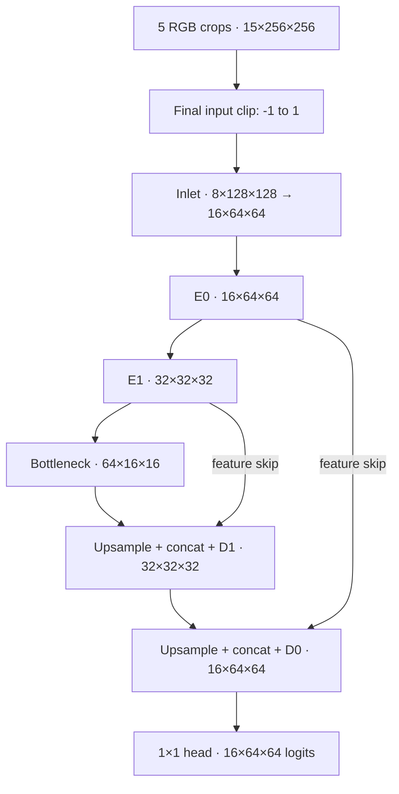
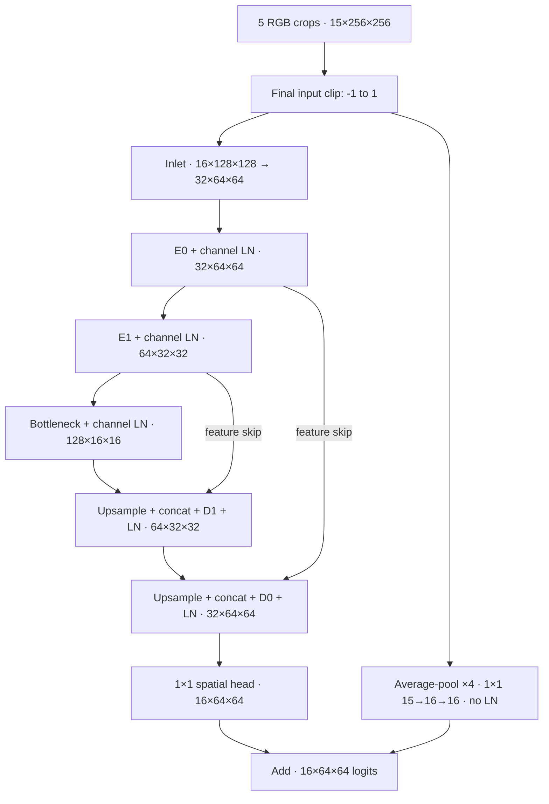
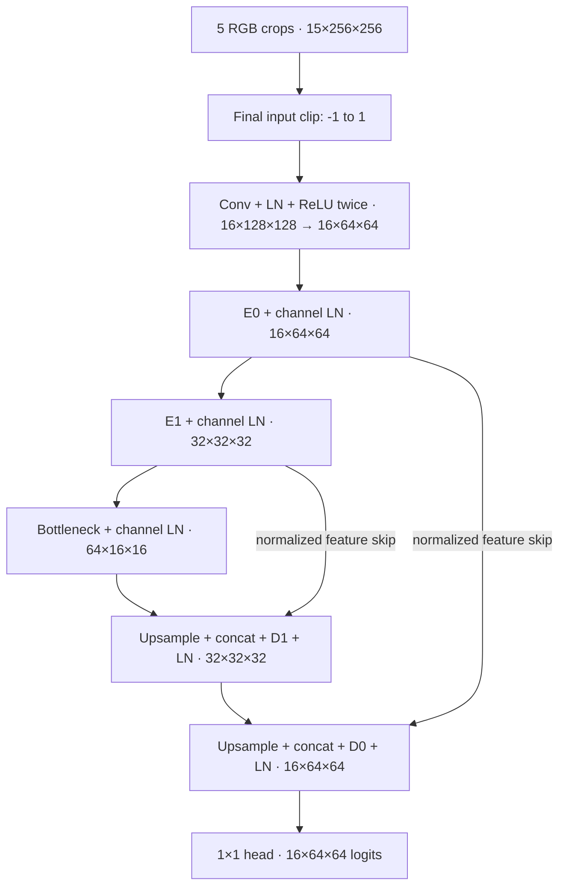

# Learned color-matrix decoder: design and training plan

Status: **G64 device feasibility established; normalized decoder evaluated; harder paired synthetics and mild real augmentation implemented**, 2026-11-02.
The submitted reports establish phone WebGPU and PC WASM parity and speed at G64. PC crop acquisition and G128 device
measurements remain open. Use [the M2 guide](OPTICAL_DECODER_TRAINING.md) for capture, synthetic generation, training,
and held-out evaluation, and [Decoder Lab](DECODER_LAB.md) for checkpoint parity/device timing. Real-data model
improvement and live learned recovery remain unvalidated. The immediate goal is browser-to-browser authentication
using the existing Neural ZKBoo engine and color optical transport. This receiver improvement belongs to the shortest
path in [ROADMAP.md](ROADMAP.md); cryptanalytic research remains future work in
[RESEARCH_CONNECTIONS.md](RESEARCH_CONNECTIONS.md).

## Scope and first decision

Build a small U-Net-style **denoiser/classifier**: recover the transmitted palette symbol at each cell, rather than
optimize the appearance of a cleaned photograph. Keep finder detection, monochrome header validation, geometry,
Reed–Solomon (RS), CRC checks, and multipart acknowledgments. Neural inference supplies better color evidence to these
existing mechanisms. It never decides whether a proof is valid.

Start with 64×64 and 128×128 physical grids, 16 colors, and a 4-color control. Grid dimensions include reference cells.
Keep grid-8 references and RS32 while reducing phases and capture requirements experimentally. 256/512 grids, learned
geometry, ViTs, Conv3D, and resolution-specific inlet/outlet branches are deferred. Both optical directions matter; the
phone's smaller display may need a different profile. There is no requirement to use identical settings on the two
devices. Keep 32×32/four-color control packets on the current classical decoder
for the first POC; learned control decoding is optional and needs its own G=32 evaluation.

## Input and network

Let G be the physical grid size and C the active palette size. Preserve spatial texture by rectifying the payload region
to **4 pixels per cell**, hence 4G×4G RGB: 256×256 for G=64 or 512×512 for G=128. This is a sampling target, not extra
camera information; record observed camera pixels per cell and reject bad crops. The current `extractCapture()` returns
sampled cell RGB plus palette pilots; its 320-pixel whole-marker preview is not this input. Add a dense payload crop
using its validated homography and `FORMAT.payload` coordinates.

Fit the existing affine color correction from the **current exposure's** border palette, apply it to the dense crop,
divide RGB by 127.5 and subtract 1, then preserve the crop within [-1.5, 1.5].
This is the capture/storage range, including affine-correction overshoot. The
model itself applies **clip(x, -1, 1) as its first operation**, before every learned
path. Exported ONNX contains this Clip, so Python and browser inference match.
Existing recorded files and hashes remain unchanged; no dataset regeneration is
needed. The final learned-input range is the same for real and synthetic sources. Retain the reference grid in the crop; its observed colors provide local context. The reference cells retain
their fixed physical palette labels across phases. No uniform pre-calibration sequence or persistent moiré texture map
is required.

### Implemented architectures

All current profiles use biased 3×3 convolutions with padding 1 and ReLU,
nearest-neighbor decoder upsampling, concatenated learned-feature skips, and an
unnormalized 1×1 classification head. T is the number of RGB exposures (1–64).
Input is `[N,3T,4G,4G]`; output is `[N,16,G,G]`. The grid includes references,
which are excluded from the training loss and payload recovery.

| Property | Current compact | Current wide |
| --- | --- | --- |
| Inlet | 3T→8→16, two stride-2 convolutions | 3T→16→32, two stride-2 convolutions |
| Encoder widths | 16 / 32 / 64 | 32 / 64 / 128 |
| Decoder widths | 32 / 16 | 64 / 32 |
| Hidden normalization | None | Channel LayerNorm after the ten encoder/decoder convolutions; inlet remains unnormalized |
| Direct calibrated-RGB readout | None | Average-pool RGB to cells, 1×1 3T→16→16, add to spatial logits |
| Parameters at T=5 | 122,656 | 489,024 |
| Parameter formula | 121576 + 216T | 486624 + 480T |

Channel LayerNorm normalizes learned feature channels independently at each
spatial position. It does not normalize across the batch or image positions.
Input affine scaling/clipping is separate from this feature normalization.

The following diagrams show **T=5, G=64**; node sizes are channels × height ×
width. Every E/B/D block contains two convolutions. E1 and B downsample on their
first convolution. Each D block upsamples ×2, concatenates its skip, then
convolves. Both grid sizes use the same weights.

**Current compact — implemented**

**Current wide — implemented**

The RGB branch receives calibrated, fixed-range input, not unprocessed camera
RGB. It bypasses learned feature normalization and contextual mixing. At T=5 it
contains only **528 parameters**: removing it changes the information path but
barely reduces capacity. Most wide parameters are in the spatial backbone.

### Normalized compact — implemented default

`--model normalized-compact` is the fresh-training/export default. It keeps the
dense input, output grid, skip topology and convolution depth. The 16-channel
first inlet retains wide's initial width; the backbone narrows to **16/32/64**.
The existing ChannelLayerNorm follows **every hidden convolution**, including
both inlet layers, before ReLU. There is no direct RGB branch. Normalized learned
feature skips remain, and the final logits have no normalization or activation.

| Stage | Channel operations | Output spatial size |
| --- | --- | --- |
| Inlet | 3T→16→16, stride 2 each | 4G→2G→G |
| E0 | 16→16→16 | G |
| E1 | 16→32→32, first stride 2 | G/2 |
| Bottleneck | 32→64→64, first stride 2 | G/4 |
| D1 | Concatenate 64+32; 96→32→32 | G/2 |
| D0 | Concatenate 32+16; 48→16→16 | G |
| Head | 16→16, 1×1, no normalization/activation | G |

Exact parameter count, including biases and LayerNorm affine weights:
**123440 + 432T**, hence **125,600 at five frames** and **151,088 at 64**.
At five frames this is **74.3% fewer parameters** than wide. The profile is
implemented in training, strict checkpoint loading, ONNX export and the browser
contract. The input clamp adds no trainable parameters.

The architecture targets capacity and photometric shortcuts. Its first five-frame
run recovered 19/144 validation groups (13.19%), all PC→phone; phone→PC remained
0/48. This is progress, not reliable transport. Feature normalization can reduce dependence on feature scale, but
does not guarantee white-balance invariance. Do not normalize the raw RGB triplet
to unit variance: absolute color/luminance differences carry palette information.
The input calibration and reference grid remain available to learned convolutions.
Changing the internal widths needs a fresh model; wide weights cannot be loaded
unchanged. This model uses no per-frame encoder, attention or additional training objective.

### Burst sampling and evaluation

Training draws T distinct captures at random within one burst/session/target/
phase and randomizes their slot order. The RNG advances across updates. Each
exposure already has its own geometry and color correction. Synthetic members
come from one independently generated corruption burst.

Evaluation now ranks members of each burst with a **fixed seed-7 SHA-256
permutation**, then partitions that order into disjoint groups of T. It does not
partition chronological neighbors. Both standalone evaluation and in-training
validation use this one policy. Group membership and channel order are stable
across repeated evaluations, input ordering, relocated directories and unrelated
bursts. Reports record the method and seed; training history/settings record them
too. Classical and neural recovery observe exactly the same selected captures.
Remainders are reported, never duplicated; short training bursts fail explicitly.

The collection pool may already contain captures retained for diversity. Random
evaluation groups test fusion of that pool; they are not a measured streaming
latency result. The browser lab still takes T distinct current same-header video
exposures, resets on identity changes and bounds collection time/memory. Live
learned transport integration remains pending.

An explicit single→T-frame warm start of an existing profile repeats its original
RGB-facing weights across slots and divides by T. Loading/exporting a checkpoint
uses its exact validated width. Recording formats and synthetic `--frames`
semantics are unchanged.

### Remaining generalization hypotheses

The submitted five-frame run lowers validation CE to .917 at 3k, then raises it
to 3.160 at 32k while real-training CE falls .946→.071. Chronological grouping
was a mismatched evaluation condition; rerun the existing checkpoint with the
corrected grouping before attributing a precise amount of loss to overfitting.
Checkpoint ranking is not an explanation for the rising validation-loss curve.

Two further concrete design observations motivate the smaller model:

- Wide already normalizes internal features, but its inlet and additive RGB
  branch bypass that normalization. The branch can exploit session-specific
  color mappings. The normalized model removes that path and normalizes the inlet.
- Nonzero-severity synthetics already occupy [-1,1], while stored calibrated
  crops can occupy [-1.5,1.5]. The model now clips both at [-1,1] before learned
  processing, fixing this input-range mismatch while preserving the recordings.
  Artifact distributions can still differ: synthetic generation approximates
  residual calibrated distortions rather than refitting a camera calibration
  per generated exposure. The generator itself is unchanged.

Paired synthetics add nuisance variation without adding new payload content.
Limited recorded sessions/targets remain another plausible generalization limit;
random combinations cannot create new physical capture conditions. The sampling
audit found no RNG reset, missing frame-slot coverage, cross-phase pairing or
optimizer/loss arithmetic error. A narrowly reproducible unused-capture selection
bias was fixed, but the supplied run did not exercise that reuse path.

## Integrating probabilities with the existing receiver

The model predicts **physical palette IDs**. For C=4, mask logits 4–15 before softmax; C=16 uses all outputs. After
softmax, exclude reference cells using `gridLayout(...).cells`, and convert each data-cell distribution to logical
symbol order with the existing mapping:

`logicalScores[i, k] = physicalProbabilities[cell_i, paletteMap(k, info)]`.

This inversion occurs before temporal fusion. Header fields select the mapping; the model does not learn or guess phase
identity. Scale probabilities to the current 0–255 score convention, retaining float precision until a bounded pool
requires quantization. A validation-only temperature can calibrate confidence.

Add an evidence entry point to `TemporalDecoder` that accepts these logical scores; the present `process()` only accepts
RGB samples. Keep `decodeScores()` as the downstream boundary: it chooses symbols, calculates top-two margins, and calls
`decodeSymbols()`. Existing byte-reliability ranking, bounded RS erasure trials, interleaving, tail checks, and CRC
acceptance remain authoritative. Report learned and classical candidates separately and retain rejection of conflicting
CRC-valid candidates. Never feed known payloads into inference or RS.

Keep monochrome header detection/checksum entirely model-free. Bad headers and mixed display transitions cannot be
repaired by confidence alone. Continue to use complete-message integrity and the exact expected challenge/proof checks
above transport. A classifier confidence score is not authentication.

## Browser feasibility before training

Export an untrained instance and a deterministic numerical fixture before a long training run. Use PyTorch → ONNX → ONNX
Runtime Web inside a dedicated worker; pin the selected runtime/export versions and bundle model, JS, and WASM locally.
No CDN or inference server is needed during authentication. The exporter may need `onnx`/`onnxscript`; inference
validation can use Python `onnxruntime` separately.

The official [WebGPU operator table](https://github.com/microsoft/onnxruntime/blob/main/js/web/docs/webgpu-operators.md)
checked on 2026-10-19 lists Conv2D, ReLU, Concat, Resize, and Softmax support and explicitly excludes Conv3D. This
motivates the graph; it does **not** establish support or speed for our exact export. Inspect every exported
operator/opset and run numerical parity and timing on the actual phone and PC, with camera active. Use a real worker,
not the WASM proxy option for WebGPU. Explicitly test WASM-only fallback, initially single-threaded; multithreaded WASM
requires suitable browser support and cross-origin isolation. Device/backend selection must be measured.

Initial engineering targets: warm p95 inference ≤100 ms at G=64 and ≤200 ms at G=128 on each receiving device, bounded
additional working memory near 128 MiB, one in-flight inference and one replaceable pending capture. These are targets,
not gates that justify indefinite model optimization. If the target phone misses them, halve feature widths or use G=64
before adding temporal complexity. Measure preprocessing, transfers, inference, and RS separately; drop old camera
frames rather than build a queue. Existing 64 MiB evidence limits remain separate from RGB/tensor/runtime memory and
must be included in total memory reports.

## Real-device capture and ground truth

Extend the existing Optical Bench with a small **dataset capture mode**. Transmit fresh random known bytes through the
current renderer/encoder; export a sender manifest with sequence/frame/phase identifiers, profile, payload hash, and
data needed to regenerate exact encoded symbols, including parity and padding. The receiver records timestamped bursts,
homography, header fields, camera settings, pixels/cell, current reference measurements, and decoder diagnostics. Save
dense crops plus a bounded sample of original frames to allow later rectification fixes.

Join labels offline through validated IDs and the manifest. A successful payload decode is **not** required for training
capture; keep difficult failed payloads. Captures with untrusted frame/phase identity remain unlabeled until
independently resolved, rather than inheriting the last label. Exclude transition mixtures. The sender manifest/seed,
expected bytes, and labels never enter the live decoder.

Capture both PC→phone and phone→PC, including slight hand motion, focus changes, auto white balance, varied
distances/angles, display brightness, 720p/1080p, successful and unsuccessful conditions. Start with several short
sessions per direction across 64/128 and 4/16 colors. Split **whole sessions and payload seeds** before extracting
frames or patches; adjacent frames and phases of one payload must stay in the same split. Reserve a later physical
session for final testing; hold out another screen/camera pair when available. Do not claim cross-device generalization
from a single pair. Store large captures/checkpoints outside Git, with dataset manifests and hashes in the experiment's
reproducibility record.

Use the validation split for checkpoint selection and confidence calibration. Keep the final test sessions untouched
until the model and receiver settings are selected; report results on those sessions separately.

## Synthetic data and training

Use the current OBM5 JavaScript renderer as the canonical label/geometry source.
Random-payload clean corpora remain available for pretraining. For real fine-tuning,
`decoder-dataset.mjs targets` reconstructs the exact clean matrices represented by
the sender-derived bytes and metadata in a joined training dataset. It verifies
headers/labels/masks, deduplicates repeated captures of the same target, and
preserves sender/receiver session, payload and split identities. This is offline
supervision; the receiver never receives the expected matrix as an inference input.

Generate multiple independently seeded bursts for each target, with correlated
frames inside each burst:

- Render screen pixels/subpixels at higher resolution, then blur and sample to
  approximate aliasing; add curved/chirped channel-dependent moiré.
- Evolve texture, subcell motion and focus across frames. Integrate centered
  exposure samples with arbitrary-direction linear, rotational and radial-zoom
  motion blur; include illumination gradients, affine color mixing, gamma, clipping, shot/read
  noise, and residual exposure/white-balance changes.
- Approximate rolling-shutter/screen-flicker interaction using row-dependent,
  drifting exposure/color bands and a small bounded row-wise skew. Do not label
  a transition between different payloads as one static target.
- Add soft, rotated rectangle/ellipse shapes with opacity gradients: tinted
  multiplicative shadows and additive reflections/highlights, with burst motion.
- Add drifting elliptical glare: a locally saturating core and a broader tinted
  halo that reduces contrast. Draw severity per burst between configured bounds
  to retain moderate examples alongside harder conditions.

Treat these as calibrated-crop approximations, not a full camera simulator.
Randomize nuisance parameters independently of payload symbols. Preserve original
real captures. Whole sessions/payloads and their synthetic derivatives remain in
one split; synthetic targets reconstructed from validation/test must never enter
training. Matching content reduces one source of distribution difference, but
only held-out real recovery can demonstrate useful optical generalization.

Train on the user's RTX 4090 using plain PyTorch and NumPy; CPU supports small
pipeline checks. The current trainer has one ordinary masked cross-entropy path,
AdamW weight decay `.01`, effective batch 16, a 32,000-update default, and learning
rate `1e-4` fresh or `5e-5` initialized. The unsuccessful adaptation recipe and its
extra objective and plateau machinery have been removed. Real stacks now receive
mild shared tint/exposure and independent noise during training only, through
three explicit controls. The augmentation keeps calibration overshoot until the
model input clamp and leaves files, synthetic inputs and validation unchanged.
Keep useful source/group metrics and initialized-checkpoint baseline protection.

For the next experiment, continue `normalized-burst5/best.pt` at `3e-5` for 32,000
updates using the unchanged real datasets and a new paired corpus of 32 independent
bursts × 12 frames per target. Use severity .45–.9, glare and stronger photometric
limits, retaining `--frames 5 --paired-targets`. Initialization loads weights with
a fresh optimizer. Each real stack receives a synthetic stack of the exact
same session/payload/frame/phase and target hashes. The 50:50 source quota applies
to each complete optimizer update; an optional session sidecar balances real
acquisition directions. Full real validation every 1,000 updates selects by exact
recovery, then ordinary CE. Per-direction results remain essential when one
direction recovers nothing. Compare against the initialized normalized model on
the same fixed-random validation groups.
See the [training guide](OPTICAL_DECODER_TRAINING.md#recommended-next-training-run)
for generation and continuation commands.

Mask reference cells and inactive palette classes from the objective. Batch
G64/G128 profiles separately by shape. The architecture still predicts physical
palette classes from T calibrated crops; no reconstruction head or
consistency loss is needed for this paired-data experiment. Measure cell confusion
and calibration as diagnostics, and validate exact CRC recovery at equal capture
budgets. A selected checkpoint must pass PyTorch/ONNX/browser parity before live
transport integration.

## Implemented boundaries and remaining work

The model/export, separate inference lab, and M2 capture/training tools are implemented. Generated weights, fixtures, and runtime assets are
prepared locally rather than committed. The live optical receiver still uses the classical decoder.

| Location | State and responsibility |
| --- | --- |
| `experiments/optical-decoder/{model,contract,export}.py` | Implemented: exact small model, normalization, deterministic fixtures, checked ONNX exports |
| `experiments/optical-decoder/browser-runtime/` | Implemented: pinned optional runtime install, lockfile, and upstream notices |
| `scripts/prepare-decoder.mjs` | Implemented: validate and prepare local assets without downloading or deploying |
| `apps/color-optical-bench/dist/decoder.html`, `js/decoder-lab/` | Implemented: isolated worker inference, numerical comparison, timings, camera crop probe, reports |
| `apps/color-optical-bench/dist/js/{vision,learned-input}.js` | Implemented: dense physical crop and current-exposure correction, NCHW input, physical-logit to logical-score adapter |
| `experiments/optical-decoder/{data,bursts,synthetic,sampling,train,evaluate,checkpoint}.py` | Implemented M2: dataset checks, independent corruption bursts, paired sampling, training, held-out evaluation, and checkpoint validation |
| `apps/color-optical-bench/dist/capture.html`, `js/dataset/` | Implemented: static sender, bounded receiver capture, independent exports, and diagnostic originals |
| `scripts/decoder-dataset.mjs` | Implemented: clean random/recorded target rendering, offline label joins, corrupted-input baselines, and exact CRC/RS comparison |
| Existing `decoder-worker.js`, `temporal.js` | Planned integration: learned evidence entry point; classical live path unchanged |

The reusable authentication boundary is the session/envelope API in
`apps/qr-neural-key/dist/js/auth/{session,envelope}.js`; its `link.js` adapter owns QR-specific transport behavior.
M3 will preserve session and proof semantics while providing a color-link adapter. M1 does not duplicate that engine.

Milestones follow [the POC plan](ROADMAP.md): M1 browser smoke and interfaces, then M2 capture/generator/burst
training alongside M3 optical authentication integration, followed by M4 first color authentication. Four-frame
learning now belongs to M2 because single-frame training has not solved the hard direction. At each decoder comparison, report
cell error rate/confusions, raw CRC and RS/erasure-assisted exact passes, accepted wrong payloads, phases/captures/time
to recovery, p50/p95 latency, memory, and failures. Use identical recorded bursts and equal elapsed optical budgets for
A/B tests.

Promote the model when it improves held-out exact recovery or reduces observation time without degrading the 4-color
control, then test live **both directions**. Measure acknowledged application bytes/second (excluding
duplicates/parity), ACK latency/retries, and complete authentication time including proof generation and result
confirmation. Start with the existing 17,474-byte development proof and then test the 119,249-byte default proof. A
smaller development proof accelerates iteration; it does not establish stronger cryptographic security. Do not require
beating QR or decoding 256×256 before completing the color-authentication POC.

## References

- [U-Net, Ronneberger et al. (2015)](https://arxiv.org/abs/1505.04597): encoder/decoder skip connections; our compact classifier is a proposed adaptation.
- [PyTorch ONNX exporter](https://docs.pytorch.org/docs/stable/onnx.html).
- [ONNX Runtime WebGPU](https://onnxruntime.ai/docs/tutorials/web/ep-webgpu.html), [operator table](https://github.com/microsoft/onnxruntime/blob/main/js/web/docs/webgpu-operators.md), and [worker/WASM/session options](https://onnxruntime.ai/docs/tutorials/web/env-flags-and-session-options.html).
- Existing [color format](../apps/color-optical-bench/FORMAT.md), [transport](../apps/color-optical-bench/LINK_TRANSPORT.md), and [receiver source](../apps/color-optical-bench/dist/js/vision.js).
